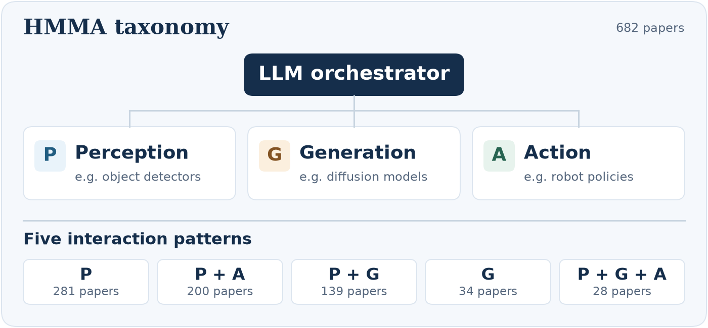
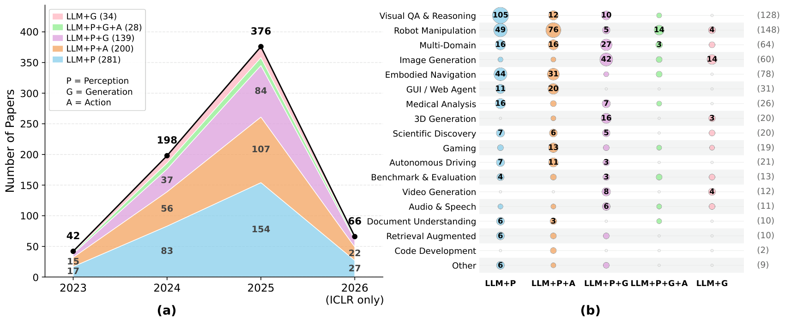

<h1 align="center">Many Models, One LLM: A Survey on Heterogeneous Multi-Model Agents</h1>

<p align="center">
  Zheng Zhang · Nanjie Yao · Yu Feng · Qi Chai · Liu Liu · Deheng Ye · Peilin Zhao · Xiangxin Zhou · Hao Wang · Hui Xiong
</p>

<p align="center">Accepted for publication in <strong>ACM Computing Surveys (CSUR)</strong></p>

<p align="center">
  <a href="#papers"></a>
  <a href="https://3dagentworld.github.io/awesome_hmma_agent/#browser"></a>
  <a href="https://doi.org/10.20944/preprints202607.1041.v1"></a>
  <a href="#citation"></a>
</p>

<p align="center">
  <picture>
    <source media="(prefers-color-scheme: dark)" srcset="docs/assets/taxonomy-overview-dark.png">
    
  </picture>
</p>

<p align="center">
  <a href="#what-are-hmmas">Taxonomy notes</a> · <a href="data/README.md">Data guide</a> · <a href="#suggest-a-paper-or-correction">Suggest a paper</a>
</p>

<!-- BEGIN PAPER CATALOG -->

<a name="robotics-extension"></a>

## Papers

**682 papers**

| Pattern | Browse | Papers |
| :---: | :--- | ---: |
| `P` | [Perception](#perception) | 281 |
| `P+A` | [Perception and action](#perception-and-action) | 200 |
| `P+G` | [Perception and generation](#perception-and-generation) | 139 |
| `G` | [Generation](#generation) | 34 |
| `P+G+A` | [Perception, generation, and action](#perception-generation-and-action) | 28 |

### Perception

<details>
<summary>Show 281 papers</summary>

| Paper | Venue | Domain | Code |
| --- | --- | --- | --- |
| [Accelerating Materials Design via LLM-Guided Evolutionary Search](https://openreview.net/pdf?id=TIqzhBvCNB) | ICLR 2026 | Scientific Discovery | [Code](https://github.com/scientific-discovery/LLEMA) |
| [Agent-X: Evaluating Deep Multimodal Reasoning in Vision-Centric Agentic Tasks](https://openreview.net/pdf?id=Vjruxvp1Xd) | ICLR 2026 | Benchmark Evaluation | [Code](https://github.com/mbzuai-oryx/Agent-X) |
| [AutoGPS: Automated Geometry Problem Solving via Multimodal Formalization and Deductive Reasoning](https://openreview.net/pdf?id=PVtZnUh04m) | ICLR 2026 | Visual QA Reasoning |  |
| [CARE: Towards Clinical Accountability in Multi-Modal Medical Reasoning with an Evidence-Grounded Agentic Framework](https://openreview.net/pdf?id=whRAOJiyHM) | ICLR 2026 | Medical Analysis |  |
| [ContextNav: Towards Agentic Multimodal In-Context Learning](https://openreview.net/pdf?id=k3DZzBl2EZ) | ICLR 2026 | Visual QA Reasoning |  |
| [CP-Agent: Context‑Aware Multimodal Reasoning for Cellular Morphological Profiling under Chemical Perturbations](https://openreview.net/pdf?id=7BLnSeWuei) | ICLR 2026 | Medical Analysis | [Code](https://github.com/letitia-zhang/CP-Agent) |
| [DreamPhase: Offline Imagination and Uncertainty-Guided Planning for Large-Language-Model Agents](https://openreview.net/pdf?id=81PJ2KPnmK) | ICLR 2026 | Multi Domain |  |
| [DriveAgent-R1: Advancing VLM-based Autonomous Driving with Active Perception and Hybrid Thinking](https://openreview.net/pdf?id=r2g8TV4nJy) | ICLR 2026 | Autonomous Driving | [Code](https://github.com/Zwc2003/DriveAgent-R1) |
| [EdiVal-Agent: An Object-Centric Framework for Automated, Fine-Grained Evaluation of Multi-Turn Editing](https://openreview.net/pdf?id=YkV0fnXgJA) | ICLR 2026 | Benchmark Evaluation | [Code](https://github.com/TianyuCodings/EdiVal) |
| [InSight-o3: Empowering Multimodal Foundation Models with Generalized Visual Search](https://openreview.net/pdf?id=vlraTIgUD3) | ICLR 2026 | Visual QA Reasoning | [Code](https://github.com/m-Just/InSight-o3) |
| [JanusVLN: Decoupling Semantics and Spatiality with Dual Implicit Memory for Vision-Language Navigation](https://openreview.net/pdf?id=RnuB0Nlbd5) | ICLR 2026 | Embodied Navigation | [Code](https://github.com/MIV-XJTU/JanusVLN) |
| [MATA: A Trainable Hierarchical Automaton System for Multi-Agent Visual Reasoning](https://openreview.net/pdf?id=fC27SxF4ba) | ICLR 2026 | Visual QA Reasoning | [Code](https://github.com/ControlNet/MATA) |
| [MMedAgent-RL: Optimizing Multi-Agent Collaboration for Multimodal Medical Reasoning](https://openreview.net/pdf?id=2awntLXwR6) | ICLR 2026 | Medical Analysis |  |
| [NePTune: A Neuro-Pythonic Framework for Tunable Compositional Reasoning on Vision-Language](https://openreview.net/pdf?id=8H0TkSusWI) | ICLR 2026 | Visual QA Reasoning | [Code](https://github.com/HLR/NePTune) |
| [No labels, No Problem: Training Visual Reasoners with Multimodal Verifiers](https://openreview.net/pdf?id=H7gtryDnVK) | ICLR 2026 | Visual QA Reasoning | [Code](https://github.com/damianomarsili/VALOR) |
| [Omni-Captioner: Data Pipeline, Models, and Benchmark for Omni Detailed Perception](https://openreview.net/pdf?id=Z091XLyVkJ) | ICLR 2026 | Multi Domain | [Code](https://github.com/ddlBoJack/Omni-Captioner) |
| [PixelCraft: A Multi-Agent system for High-Fidelity Visual Reasoning on Structured Images](https://openreview.net/pdf?id=HtpjSCs3g5) | ICLR 2026 | Visual QA Reasoning | [Code](https://github.com/microsoft/PixelCraft) |
| [PostAlign: Multimodal Grounding as a Corrective Lens for MLLMs](https://openreview.net/pdf?id=zJnPyb2xrp) | ICLR 2026 | Visual QA Reasoning |  |
| [Pursuing Minimal Sufficiency in Spatial Reasoning](https://openreview.net/pdf?id=bZAKJwyn1n) | ICLR 2026 | Visual QA Reasoning | [Code](https://github.com/gyj155/mssr) |
| [SAM-Veteran: An MLLM-Based Human-like SAM Agent for Reasoning Segmentation](https://openreview.net/pdf?id=oN55r8iJJW) | ICLR 2026 | Visual QA Reasoning |  |
| [SceneCOT: Eliciting Chain-of-Thought Reasoning in 3D Scenes](https://openreview.net/pdf?id=U9meoc0Sau) | ICLR 2026 | Visual QA Reasoning |  |
| [Seeing, Listening, Remembering, and Reasoning: A Multimodal Agent with Long-Term Memory](https://openreview.net/pdf?id=PMz29A7Muq) | ICLR 2026 | Visual QA Reasoning |  |
| [TimeSearch-R: Adaptive Temporal Search for Long-Form Video Understanding via Self-Verification Reinforcement Learning](https://openreview.net/pdf?id=gqb1hvuGcj) | ICLR 2026 | Visual QA Reasoning | [Code](https://github.com/Time-Search/TimeSearch-R) |
| [Transductive Visual Programming: Evolving Tool Libraries from Experience for Spatial Reasoning](https://openreview.net/pdf?id=XCW1l9qcxy) | ICLR 2026 | Visual QA Reasoning | [Code](https://github.com/transductive-visualprogram/tvp) |
| [TumorChain: Interleaved Multimodal Chain-of-Thought Reasoning for Traceable Clinical Tumor Analysis](https://openreview.net/pdf?id=bmQXN1Kg5i) | ICLR 2026 | Medical Analysis | [Code](https://github.com/ZJU4HealthCare/TumorChain) |
| [Urban Socio-Semantic Segmentation with Vision-Language Reasoning](https://openreview.net/pdf?id=sVN9K0BLQj) | ICLR 2026 | Visual QA Reasoning |  |
| [Video-STAR: Reinforcing Open-Vocabulary Action Recognition with Tools](https://openreview.net/pdf?id=NBOHB6aYZh) | ICLR 2026 | Visual QA Reasoning |  |
| [ChatterBox: Multimodal Referring and Grounding with Chain-of-Questions](https://ojs.aaai.org/index.php/AAAI/article/view/32796/34951) | AAAI 2025 | Visual QA Reasoning | [Code](https://github.com/sunsmarterjie/ChatterBox) |
| [Combating Multimodal LLM Hallucination via Bottom-Up Holistic Reasoning](https://ojs.aaai.org/index.php/AAAI/article/view/32913/35068) | AAAI 2025 | Visual QA Reasoning |  |
| [Enhancing Multi-Robot Semantic Navigation Through Multimodal Chain-of-Thought Score Collaboration](https://ojs.aaai.org/index.php/AAAI/article/view/33607/35762) | AAAI 2025 | Embodied Navigation |  |
| [GenAL: Generative Agent for Adaptive Learning](https://ojs.aaai.org/index.php/AAAI/article/view/32038/34193) | AAAI 2025 | Other | [Code](https://github.com/karin0018/GenAL) |
| [Multi-Modal Grounded Planning and Efficient Replanning for Learning Embodied Agents with a Few Examples](https://ojs.aaai.org/index.php/AAAI/article/view/32455/34610) | AAAI 2025 | Robot Manipulation |  |
| [MuMA-ToM: Multi-modal Multi-Agent Theory of Mind](https://ojs.aaai.org/index.php/AAAI/article/view/32142/34297) | AAAI 2025 | Visual QA Reasoning |  |
| [PhishAgent: A Robust Multimodal Agent for Phishing Webpage Detection](https://ojs.aaai.org/index.php/AAAI/article/view/35003/37158) | AAAI 2025 | GUI Web Agent |  |
| [Pioneering Explainable Video Fact-Checking with a New Dataset and Multi-role Multimodal Model Approach](https://ojs.aaai.org/index.php/AAAI/article/view/35048/37203) | AAAI 2025 | Visual QA Reasoning | [Code](https://github.com/MeiTaylor/TRUE-3MFact) |
| [SYNAPSE: SYmbolic Neural-Aided Preference Synthesis Engine](https://ojs.aaai.org/index.php/AAAI/article/view/34965/37120) | AAAI 2025 | Embodied Navigation |  |
| [Unleashing the Temporal-Spatial Reasoning Capacity of GPT for Training-Free Audio and Language Referenced Video Object Segmentation](https://ojs.aaai.org/index.php/AAAI/article/view/32387/34542) | AAAI 2025 | Visual QA Reasoning | [Code](https://github.com/appletea233/AL-Ref-SAM2) |
| [VIoTGPT: Learning to Schedule Vision Tools Towards Intelligent Video Internet of Things](https://ojs.aaai.org/index.php/AAAI/article/view/33160/35315) | AAAI 2025 | Visual QA Reasoning | [Code](https://github.com/zhongyy/VIoTGPT) |
| [A Unified Agentic Framework for Evaluating Conditional Image Generation](https://aclanthology.org/2025.acl-long.620.pdf) | ACL 2025 | Benchmark Evaluation |  |
| [CityNavAgent: Aerial Vision-and-Language Navigation with Hierarchical Semantic Planning and Global Memory](https://aclanthology.org/2025.acl-long.1511.pdf) | ACL 2025 | Embodied Navigation |  |
| [Doc-React: Multi-page Heterogeneous Document Question-answering](https://aclanthology.org/2025.acl-short.6.pdf) | ACL 2025 | Document Understanding |  |
| [Enhancing Interpretable Image Classification Through LLM Agents and Conditional Concept Bottleneck Models](https://aclanthology.org/2025.acl-long.600.pdf) | ACL 2025 | Visual QA Reasoning |  |
| [Fast or Slow? Integrating Fast Intuition and Deliberate Thinking for Enhancing Visual Question Answering](https://aclanthology.org/2025.acl-short.41.pdf) | ACL 2025 | Visual QA Reasoning |  |
| [Query-Driven Multimodal GraphRAG: Dynamic Local Knowledge Graph Construction for Online Reasoning](https://aclanthology.org/2025.findings-acl.1100.pdf) | ACL 2025 | Visual QA Reasoning |  |
| [RATE-Nav: Region-Aware Termination Enhancement for Zero-shot Object Navigation with Vision-Language Models](https://aclanthology.org/2025.findings-acl.341.pdf) | ACL 2025 | Embodied Navigation |  |
| [ReflecTool: Towards Reflection-Aware Tool-Augmented Clinical Agents](https://aclanthology.org/2025.acl-long.663.pdf) | ACL 2025 | Medical Analysis | [Code](https://github.com/BlueZeros/ReflecTool) |
| [VQAGuider: Guiding Multimodal Large Language Models to Answer Complex Video Questions](https://aclanthology.org/2025.acl-long.385.pdf) | ACL 2025 | Visual QA Reasoning | [Code](https://github.com/Yukyin/VQAGuider) |
| [Can I Trust You? Advancing GUI Task Automation with Action Trust Score](https://doi.org/10.1145/3746027.3755618) | ACMMM 2025 | GUI Web Agent | [Code](https://github.com/showlab/TrustScorer) |
| [FineQuest: Adaptive Knowledge-Assisted Sports Video Understanding via Agent-of-Thoughts Reasoning](https://doi.org/10.1145/3746027.3754885) | ACMMM 2025 | Visual QA Reasoning |  |
| [GraphVideoAgent: Enhancing Long-form Video Understanding with Entity Relation Graphs](https://doi.org/10.1145/3746027.3755537) | ACMMM 2025 | Visual QA Reasoning |  |
| [HEAR: A Holistic Extraction and Agentic Reasoning Framework for Document Understanding](https://doi.org/10.1145/3746027.3761999) | ACMMM 2025 | Document Understanding | [Code](https://github.com/py-pdf/pypdf) |
| [I2CR: Intra- and Inter-modal Collaborative Reflections for Multimodal Entity Linking](https://doi.org/10.1145/3746027.3755674) | ACMMM 2025 | Retrieval Augmented | [Code](https://github.com/ziyan-xiaoyu/I2CR) |
| [Learning to Be a Doctor: Searching for Effective Medical Agent Architectures](https://doi.org/10.1145/3746027.3755559) | ACMMM 2025 | Medical Analysis |  |
| [Multi-Agent System for Comprehensive Soccer Understanding](https://doi.org/10.1145/3746027.3755144) | ACMMM 2025 | Visual QA Reasoning |  |
| [OpenMap: Instruction Grounding via Open-Vocabulary Visual-Language Mapping](https://doi.org/10.1145/3746027.3754887) | ACMMM 2025 | Embodied Navigation | [Code](https://github.com/openmap-project/OpenMap) |
| [ScreenSpot-Pro: GUI Grounding for Professional High-Resolution Computer Use](https://doi.org/10.1145/3746027.3755688) | ACMMM 2025 | GUI Web Agent | [Code](https://github.com/likaixin2000/ScreenSpot-Pro-GUI-Grounding) |
| [The Eye of Sherlock Holmes: Uncovering User Private Attribute Profiling via Vision-Language Model Agentic Framework](https://doi.org/10.1145/3746027.3755643) | ACMMM 2025 | Visual QA Reasoning |  |
| [VL-DynaRefine: A Vision-Language Dynamic Refinement Approach for Visual Reasoning](https://doi.org/10.1145/3746027.3755296) | ACMMM 2025 | Visual QA Reasoning | [Code](https://github.com/jinaicode/DynaRefine) |
| [AutoProteinEngine: A Large Language Model Driven Agent Framework for Multimodal AutoML in Protein Engineering](https://aclanthology.org/2025.coling-industry.36/) | COLING 2025 | Scientific Discovery | [Code](https://github.com/tsynbio/AutoPE) |
| [EffiQA: Efficient Question-Answering with Strategic Multi-Model Collaboration on Knowledge Graphs](https://aclanthology.org/2025.coling-main.479/) | COLING 2025 | Retrieval Augmented |  |
| [LAW: Legal Agentic Workflows for Custody and Fund Services Contracts](https://aclanthology.org/2025.coling-industry.50/) | COLING 2025 | Document Understanding | [Code](https://github.com/rapidfuzz/RapidFuzz) |
| [Agent S2: A Compositional Generalist-Specialist Framework for Computer Use Agents](https://openreview.net/pdf?id=zg5is4GJ3R) | COLM 2025 | GUI Web Agent | [Code](https://github.com/simular-ai/Agent-S) |
| [Plancraft: an evaluation dataset for planning with LLM agents](https://openreview.net/pdf?id=nSV8Depcpx) | COLM 2025 | Gaming | [Code](https://github.com/gautierdag/plancraft) |
| [VisualTrap: A Stealthy Backdoor Attack on GUI Agents via Visual Grounding Manipulation](https://openreview.net/pdf?id=7HPuAkgdVm) | COLM 2025 | GUI Web Agent |  |
| [Enter the Mind Palace: Reasoning and Planning for Long-term Active Embodied Question Answering](https://openreview.net/pdf?id=4eMWCoWUKR) | CoRL 2025 | Embodied Navigation |  |
| [GC-VLN: Instruction as Graph Constraints for Training-free Vision-and-Language Navigation](https://openreview.net/pdf?id=mjYKNIRqpy) | CoRL 2025 | Embodied Navigation |  |
| [GraphEQA: Using 3D Semantic Scene Graphs for Real-time Embodied Question Answering](https://openreview.net/pdf?id=Yy9EVIajH5) | CoRL 2025 | Embodied Navigation |  |
| [Human-like Navigation in a World Built for Humans](https://openreview.net/pdf?id=nMiyWyNhQx) | CoRL 2025 | Embodied Navigation |  |
| [Robot Operating Home Appliances by Reading User Manuals](https://openreview.net/pdf?id=wZUQq0JaL6) | CoRL 2025 | Robot Manipulation |  |
| [SAVOR: Skill Affordance Learning from Visuo-Haptic Perception for Robot-Assisted Bite Acquisition](https://openreview.net/pdf?id=VrNSv02Xfu) | CoRL 2025 | Robot Manipulation |  |
| [Chain of Semantics Programming in 3D Gaussian Splatting Representation for 3D Vision Grounding](https://openaccess.thecvf.com/content/CVPR2025/papers/Shi_Chain_of_Semantics_Programming_in_3D_Gaussian_Splatting_Representation_for_CVPR_2025_paper.pdf) | CVPR 2025 | Visual QA Reasoning |  |
| [DiSciPLE: Learning Interpretable Programs for Scientific Visual Discovery](https://openaccess.thecvf.com/content/CVPR2025/papers/Mall_DiSciPLE_Learning_Interpretable_Programs_for_Scientific_Visual_Discovery_CVPR_2025_paper.pdf) | CVPR 2025 | Scientific Discovery |  |
| [DrVideo: Document Retrieval Based Long Video Understanding](https://openaccess.thecvf.com/content/CVPR2025/papers/Ma_DrVideo_Document_Retrieval_Based_Long_Video_Understanding_CVPR_2025_paper.pdf) | CVPR 2025 | Visual QA Reasoning | [Code](https://github.com/Upper9527/DrVideo) |
| [DyFo: A Training-Free Dynamic Focus Visual Search for Enhancing LMMs in Fine-Grained Visual Understanding](https://openaccess.thecvf.com/content/CVPR2025/papers/Li_DyFo_A_Training-Free_Dynamic_Focus_Visual_Search_for_Enhancing_LMMs_CVPR_2025_paper.pdf) | CVPR 2025 | Visual QA Reasoning |  |
| [Enhancing Video-LLM Reasoning via Agent-of-Thoughts Distillation](https://openaccess.thecvf.com/content/CVPR2025/papers/Shi_Enhancing_Video-LLM_Reasoning_via_Agent-of-Thoughts_Distillation_CVPR_2025_paper.pdf) | CVPR 2025 | Visual QA Reasoning | [Code](https://github.com/zhengrongz/AoTD) |
| [FactCheXcker: Mitigating Measurement Hallucinations in Chest X-ray Report Generation Models](https://openaccess.thecvf.com/content/CVPR2025/papers/Heiman_FactCheXcker_Mitigating_Measurement_Hallucinations_in_Chest_X-ray_Report_Generation_Models_CVPR_2025_paper.pdf) | CVPR 2025 | Medical Analysis | [Code](https://github.com/rajpurkarlab/FactCheXcker) |
| [PEACE: Empowering Geologic Map Holistic Understanding with MLLMs](https://openaccess.thecvf.com/content/CVPR2025/papers/Huang_PEACE_Empowering_Geologic_Map_Holistic_Understanding_with_MLLMs_CVPR_2025_paper.pdf) | CVPR 2025 | Visual QA Reasoning | [Code](https://github.com/microsoft/PEACE) |
| [ReasonGrounder: LVLM-Guided Hierarchical Feature Splatting for Open-Vocabulary 3D Visual Grounding and Reasoning](https://openaccess.thecvf.com/content/CVPR2025/papers/Liu_ReasonGrounder_LVLM-Guided_Hierarchical_Feature_Splatting_for_Open-Vocabulary_3D_Visual_Grounding_CVPR_2025_paper.pdf) | CVPR 2025 | Visual QA Reasoning |  |
| [VideoTree: Adaptive Tree-based Video Representation for LLM Reasoning on Long Videos](https://openaccess.thecvf.com/content/CVPR2025/papers/Wang_VideoTree_Adaptive_Tree-based_Video_Representation_for_LLM_Reasoning_on_Long_CVPR_2025_paper.pdf) | CVPR 2025 | Visual QA Reasoning | [Code](https://github.com/Ziyang412/VideoTree) |
| [VILA-M3: Enhancing Vision-Language Models with Medical Expert Knowledge](https://openaccess.thecvf.com/content/CVPR2025/papers/Nath_VILA-M3_Enhancing_Vision-Language_Models_with_Medical_Expert_Knowledge_CVPR_2025_paper.pdf) | CVPR 2025 | Medical Analysis |  |
| [Visual Agentic AI for Spatial Reasoning with a Dynamic API](https://openaccess.thecvf.com/content/CVPR2025/papers/Marsili_Visual_Agentic_AI_for_Spatial_Reasoning_with_a_Dynamic_API_CVPR_2025_paper.pdf) | CVPR 2025 | Visual QA Reasoning | [Code](https://github.com/damianomarsili/VADAR) |
| [3MDBench: Medical Multimodal Multi-agent Dialogue Benchmark](https://aclanthology.org/2025.emnlp-main.1353.pdf) | EMNLP 2025 | Medical Analysis | [Code](https://github.com/univanxx/3mdbench) |
| [AgentThink: A Unified Framework for Tool-Augmented Chain-of-Thought Reasoning in Vision-Language Models for Autonomous Driving](https://aclanthology.org/2025.findings-emnlp.564.pdf) | EMNLP 2025 | Autonomous Driving | [Code](https://github.com/curryqka/AgentThink) |
| [AMANDA: Agentic Medical Knowledge Augmentation for Data-Efficient Medical Visual Question Answering](https://aclanthology.org/2025.findings-emnlp.1350.pdf) | EMNLP 2025 | Medical Analysis | [Code](https://github.com/REAL-Lab-NU/AMANDA) |
| [CityEQA: A Hierarchical LLM Agent on Embodied Question Answering Benchmark in City Space](https://aclanthology.org/2025.emnlp-main.630.pdf) | EMNLP 2025 | Embodied Navigation | [Code](https://github.com/tsinghua-fib-lab/CityEQA.git) |
| [DASR: Distributed Adaptive Scene Recognition - A Multi-Agent Cloud-Edge Framework for Language-Guided Scene Detection](https://aclanthology.org/2025.emnlp-industry.57.pdf) | EMNLP 2025 | Autonomous Driving |  |
| [Follow the Flow: Fine-grained Flowchart Attribution with Neurosymbolic Agents](https://aclanthology.org/2025.emnlp-main.1144.pdf) | EMNLP 2025 | Document Understanding |  |
| [GraphAgent: Agentic Graph Language Assistant](https://aclanthology.org/2025.emnlp-main.1339.pdf) | EMNLP 2025 | Multi Domain | [Code](https://github.com/HKUDS/GraphAgent) |
| [LATTE: Learning to Think with Vision Specialists](https://aclanthology.org/2025.emnlp-main.564.pdf) | EMNLP 2025 | Visual QA Reasoning | [Code](https://github.com/SalesforceAIResearch/LATTE) |
| [Med-VRAgent: A Framework for Medical Visual Reasoning-Enhanced Agents](https://aclanthology.org/2025.emnlp-main.939.pdf) | EMNLP 2025 | Medical Analysis |  |
| [MEXA: Towards General Multimodal Reasoning with Dynamic Multi-Expert Aggregation](https://aclanthology.org/2025.findings-emnlp.1233.pdf) | EMNLP 2025 | Multi Domain | [Code](https://github.com/Yui010206/MEXA) |
| [MMAPG: A Training-Free Framework for Multimodal Multi-hop Question Answering via Adaptive Planning Graphs](https://aclanthology.org/2025.emnlp-main.717.pdf) | EMNLP 2025 | Visual QA Reasoning |  |
| [OAgents: An Empirical Study of Building Effective Agents](https://aclanthology.org/2025.findings-emnlp.720.pdf) | EMNLP 2025 | Benchmark Evaluation |  |
| [ProReason: Multi-Modal Proactive Reasoning with Decoupled Eyesight and Wisdom](https://aclanthology.org/2025.emnlp-main.1614.pdf) | EMNLP 2025 | Visual QA Reasoning | [Code](https://github.com/lian-tian-mo-zun/Pro_Reason) |
| [ReAL: How Can LLMs Simulate the Real Teacher? Retrieval-enhanced Agent for Adaptive Learning](https://aclanthology.org/2025.findings-emnlp.11.pdf) | EMNLP 2025 | Other | [Code](https://github.com/karin0018/ReAL) |
| [VistaWise: Building Cost-Effective Agent with Cross-Modal Knowledge Graph for Minecraft](https://aclanthology.org/2025.emnlp-main.1111.pdf) | EMNLP 2025 | Gaming | [Code](https://github.com/PrismarineJS/mineflayer) |
| [Visual Program Distillation with Template-Based Augmentation](https://aclanthology.org/2025.findings-emnlp.162.pdf) | EMNLP 2025 | Visual QA Reasoning | [Code](https://github.com/michalsr/vp_distill_) |
| [“Where Does This Strange Smell Come from?”: Enabling Conversational Interfaces for Artificial Olfaction](https://aclanthology.org/2025.findings-emnlp.567.pdf) | EMNLP 2025 | Other | [Code](https://github.com/HokyeeJau/CIAO) |
| [Beyond the Destination: A Novel Benchmark for Exploration-Aware Embodied Question Answering](https://openaccess.thecvf.com/content/ICCV2025/papers/Jiang_Beyond_the_Destination_A_Novel_Benchmark_for_Exploration-Aware_Embodied_Question_ICCV_2025_paper.pdf) | ICCV 2025 | Embodied Navigation | [Code](https://github.com/HCPLab-SYSU/EXPRESS-Bench) |
| [CAD-Assistant: Tool-Augmented VLLMs as Generic CAD Task Solvers](https://openaccess.thecvf.com/content/ICCV2025/papers/Mallis_CAD-Assistant_Tool-Augmented_VLLMs_as_Generic_CAD_Task_Solvers_ICCV_2025_paper.pdf) | ICCV 2025 | Multi Domain | [Code](https://github.com/dimitrismallis/CAD-) |
| [CogNav: Cognitive Process Modeling for Object Goal Navigation with LLMs](https://openaccess.thecvf.com/content/ICCV2025/papers/Cao_CogNav_Cognitive_Process_Modeling_for_Object_Goal_Navigation_with_LLMs_ICCV_2025_paper.pdf) | ICCV 2025 | Embodied Navigation | [Code](https://github.com/yhanCao/CogNav_ObjNav) |
| [DWIM: Towards Tool-aware Visual Reasoning via Discrepancy-aware Workflow Generation & Instruct-Masking Tuning](https://openaccess.thecvf.com/content/ICCV2025/papers/Ke_DWIM_Towards_Tool-aware_Visual_Reasoning_via_Discrepancy-aware_Workflow_Generation__ICCV_2025_paper.pdf) | ICCV 2025 | Visual QA Reasoning | [Code](https://github.com/pokerme7777/DWIM) |
| [MMAT-1M: A Large Reasoning Dataset for Multimodal Agent Tuning](https://openaccess.thecvf.com/content/ICCV2025/papers/Gao_MMAT-1M_A_Large_Reasoning_Dataset_for_Multimodal_Agent_Tuning_ICCV_2025_paper.pdf) | ICCV 2025 | Multi Domain | [Code](https://github.com/VIS-MPU-Agent/MMAT-1M) |
| [Multimodal LLM Guided Exploration and Active Mapping using Fisher Information](https://openaccess.thecvf.com/content/ICCV2025/papers/Jiang_Multimodal_LLM_Guided_Exploration_and_Active_Mapping_using_Fisher_Information_ICCV_2025_paper.pdf) | ICCV 2025 | Embodied Navigation |  |
| [NAVER: A Neuro-Symbolic Compositional Automaton for Visual Grounding with Explicit Logic Reasoning](https://openaccess.thecvf.com/content/ICCV2025/papers/Cai_NAVER_A_Neuro-Symbolic_Compositional_Automaton_for_Visual_Grounding_with_Explicit_ICCV_2025_paper.pdf) | ICCV 2025 | Visual QA Reasoning | [Code](https://github.com/ControlNet/NAVER) |
| [Online Reasoning Video Segmentation with Just-in-Time Digital Twins](https://openaccess.thecvf.com/content/ICCV2025/papers/Shen_Online_Reasoning_Video_Segmentation_with_Just-in-Time_Digital_Twins_ICCV_2025_paper.pdf) | ICCV 2025 | Visual QA Reasoning | [Code](https://github.com/yiqings/jitbench) |
| [PASG: A Closed-Loop Framework for Automated Geometric Primitive Extraction and Semantic Anchoring in Robotic Manipulation](https://openaccess.thecvf.com/content/ICCV2025/papers/Zhu_PASG_A_Closed-Loop_Framework_for_Automated_Geometric_Primitive_Extraction_and_ICCV_2025_paper.pdf) | ICCV 2025 | Robot Manipulation |  |
| [Perspective-Aware Reasoning in Vision-Language Models via Mental Imagery Simulation](https://openaccess.thecvf.com/content/ICCV2025/papers/Lee_Perspective-Aware_Reasoning_in_Vision-Language_Models_via_Mental_Imagery_Simulation_ICCV_2025_paper.pdf) | ICCV 2025 | Visual QA Reasoning | [Code](https://github.com/KAIST-Visual-AI-Group/APC-VLM) |
| [Physics Context Builders: A Modular Framework for Physical Reasoning in Vision-Language Models](https://openaccess.thecvf.com/content/ICCV2025/papers/Balazadeh_Physics_Context_Builders_A_Modular_Framework_for_Physical_Reasoning_in_ICCV_2025_paper.pdf) | ICCV 2025 | Visual QA Reasoning |  |
| [AnyPrefer: An Automatic Framework for Preference Data Synthesis](https://openreview.net/pdf?id=WpZyPk79Fu) | ICLR 2025 | Multi Domain |  |
| [Autonomous agents from automatic reward modeling and planning](https://openreview.net/pdf?id=womU9cEwcO) | ICLR 2025 | Multi Domain | [Code](https://github.com/heaplax/ARMAP) |
| [Benchmarking Multimodal Retrieval Augmented Generation with Dynamic VQA Dataset and Self-adaptive Planning Agent](https://openreview.net/pdf?id=VvDEuyVXkG) | ICLR 2025 | Retrieval Augmented | [Code](https://github.com/Alibaba-NLP/OmniSearch) |
| [Dissecting Adversarial Robustness of Multimodal LM Agents](https://openreview.net/pdf?id=YauQYh2k1g) | ICLR 2025 | GUI Web Agent |  |
| [Re-Aligning Language to Visual Objects with an Agentic Workflow](https://openreview.net/pdf?id=MPJ4SMnScw) | ICLR 2025 | Visual QA Reasoning | [Code](https://github.com/FishAndWasabi/RealLOD) |
| [Video Action Differencing](https://openreview.net/pdf?id=3bcN6xlO6f) | ICLR 2025 | Multi Domain | [Code](https://github.com/jmhb0/viddiff) |
| [Agent Reviewers: Domain-specific Multimodal Agents with Shared Memory for Paper Review](https://openreview.net/pdf?id=s7HUJamWqX) | ICML 2025 | Document Understanding |  |
| [DEFAME: Dynamic Evidence-based FAct-checking with Multimodal Experts](https://openreview.net/pdf?id=umT6rMf1Rm) | ICML 2025 | Retrieval Augmented | [Code](https://github.com/mendableai/firecrawl) |
| [Modularized Self-Reflected Video Reasoner for Multimodal LLM with Application to Video Question Answering](https://openreview.net/pdf?id=dtmTQawQN2) | ICML 2025 | Visual QA Reasoning |  |
| [Perception in Reflection](https://openreview.net/pdf?id=YqerkYZfvu) | ICML 2025 | Visual QA Reasoning | [Code](https://github.com/weiyana/RePer) |
| [Toward Robust Hyper-Detailed Image Captioning: A Multiagent Approach and Dual Evaluation Metrics for Factuality and Coverage](https://openreview.net/pdf?id=REnIf3dCsI) | ICML 2025 | Visual QA Reasoning |  |
| [Windows Agent Arena: Evaluating Multi-Modal OS Agents at Scale](https://openreview.net/pdf?id=W9s817KqYf) | ICML 2025 | GUI Web Agent | [Code](https://github.com/dockur/windows) |
| [Beyond Bare Queries: Open-Vocabulary Object Grounding with 3D Scene Graph](https://doi.org/10.1109/icra55743.2025.11128059) | ICRA 2025 | Visual QA Reasoning |  |
| [BUMBLE: Unifying Reasoning and Acting with Vision-Language Models for Building-wide Mobile Manipulation](https://doi.org/10.1109/icra55743.2025.11128444) | ICRA 2025 | Robot Manipulation |  |
| [Chain-of-Modality: Learning Manipulation Programs from Multimodal Human Videos with Vision-Language-Models](https://doi.org/10.1109/icra55743.2025.11128270) | ICRA 2025 | Robot Manipulation |  |
| [Chameleon: Fast-Slow Neuro-Symbolic Lane Topology Extraction](https://doi.org/10.1109/icra55743.2025.11127684) | ICRA 2025 | Autonomous Driving |  |
| [Closed-Loop Open-Vocabulary Mobile Manipulation with GPT-4V](https://doi.org/10.1109/icra55743.2025.11127975) | ICRA 2025 | Robot Manipulation |  |
| [COHERENT: Collaboration of Heterogeneous Multi-Robot System with Large Language Models](https://doi.org/10.1109/icra55743.2025.11127808) | ICRA 2025 | Multi Domain |  |
| [ConceptAgent: LLM-Driven Precondition Grounding and Tree Search for Robust Task Planning and Execution](https://doi.org/10.1109/icra55743.2025.11128414) | ICRA 2025 | Robot Manipulation |  |
| [Fast and Accurate Task Planning using Neuro-Symbolic Language Models and Multi-Level Goal Decomposition](https://doi.org/10.1109/icra55743.2025.11127617) | ICRA 2025 | Robot Manipulation |  |
| [Here's your PDDL Problem File! On Using VLMs for Generating Symbolic PDDL Problem Files](https://doi.org/10.1109/icra55743.2025.11127832) | ICRA 2025 | Robot Manipulation |  |
| [In-Context Learning Enables Robot Action Prediction in LLMs](https://doi.org/10.1109/icra55743.2025.11128807) | ICRA 2025 | Robot Manipulation |  |
| [Interaction-Driven Updates: 3D Scene Graph Maintenance During Robot Task Execution](https://doi.org/10.1109/icra55743.2025.11128194) | ICRA 2025 | Robot Manipulation |  |
| [LEMMo-Plan: LLM-Enhanced Learning from Multi-Modal Demonstration for Planning Sequential Contact-Rich Manipulation Tasks](https://doi.org/10.1109/icra55743.2025.11127842) | ICRA 2025 | Robot Manipulation |  |
| [MultiTalk: Introspective and Extrospective Dialogue for Human-Environment-LLM Alignment](https://doi.org/10.1109/icra55743.2025.11128486) | ICRA 2025 | Robot Manipulation |  |
| [QueryCAD: Grounded Question Answering for CAD Models](https://doi.org/10.1109/icra55743.2025.11128709) | ICRA 2025 | Robot Manipulation |  |
| [ReMEmbR: Building and Reasoning Over Long-Horizon Spatio-Temporal Memory for Robot Navigation](https://doi.org/10.1109/icra55743.2025.11127706) | ICRA 2025 | Embodied Navigation |  |
| [Socratic Planner: Self-QA-Based Zero-Shot Planning for Embodied Instruction Following](https://doi.org/10.1109/icra55743.2025.11128677) | ICRA 2025 | Robot Manipulation |  |
| [SPINE: Online Semantic Planning for Missions with Incomplete Natural Language Specifications in Unstructured Environments](https://doi.org/10.1109/icra55743.2025.11128238) | ICRA 2025 | Embodied Navigation |  |
| [SYNERGAI: Perception Alignment for Human-Robot Collaboration](https://doi.org/10.1109/icra55743.2025.11128658) | ICRA 2025 | Robot Manipulation |  |
| [Verifiably Following Complex Robot Instructions with Foundation Models](https://doi.org/10.1109/icra55743.2025.11127418) | ICRA 2025 | Robot Manipulation |  |
| [Selective Invocation for Multilingual ASR: A Cost-effective Approach Adapting to Speech Recognition Difficulty](https://www.isca-archive.org/interspeech_2025/xue25_interspeech.pdf) | INTERSPEECH 2025 | Audio Speech |  |
| [Autonomous Subtask Generation for Indoor Search and Rescue Mission via Large-Language-Model and Behavior-Tree Integration](https://doi.org/10.1109/iros60139.2025.11245939) | IROS 2025 | Embodied Navigation |  |
| [CLEA: Closed-Loop Embodied Agent for Enhancing Task Execution in Dynamic Environments](https://doi.org/10.1109/iros60139.2025.11246638) | IROS 2025 | Robot Manipulation |  |
| [EfficientEQA: An Efficient Approach to Open-Vocabulary Embodied Question Answering](https://doi.org/10.1109/iros60139.2025.11247438) | IROS 2025 | Embodied Navigation |  |
| [Embodied Instruction Following in Unknown Environments](https://doi.org/10.1109/iros60139.2025.11246127) | IROS 2025 | Embodied Navigation |  |
| [Interactive Object Detection by Mitigating Uncertainty of Robot Task Plans using Large Language Model](https://doi.org/10.1109/iros60139.2025.11246834) | IROS 2025 | Robot Manipulation |  |
| [LBAP: Improved Uncertainty Alignment of LLM Planners using Bayesian Inference](https://doi.org/10.1109/iros60139.2025.11245905) | IROS 2025 | Robot Manipulation |  |
| [LightPlanner: Unleashing the Reasoning Capabilities of Lightweight Large Language Models in Task Planning](https://doi.org/10.1109/iros60139.2025.11247436) | IROS 2025 | Robot Manipulation |  |
| [MovSAM: A Single-image Moving Object Segmentation Framework Based on Deep Thinking](https://doi.org/10.1109/iros60139.2025.11246064) | IROS 2025 | Autonomous Driving |  |
| [OpenNav: Open-World Navigation with Multimodal Large Language Models](https://doi.org/10.1109/iros60139.2025.11247593) | IROS 2025 | Embodied Navigation |  |
| [Robotic Programmer: Video Instructed Policy Code Generation for Robotic Manipulation](https://doi.org/10.1109/iros60139.2025.11247043) | IROS 2025 | Robot Manipulation |  |
| [SDA-LLM: Spatial DisAmbiguation via Multi-turn Vision-Language Dialogues for Robot Navigation](https://doi.org/10.1109/iros60139.2025.11246115) | IROS 2025 | Embodied Navigation |  |
| [VLM See, Robot Do: Human Demo Video to Robot Action Plan via Vision Language Model](https://doi.org/10.1109/iros60139.2025.11246682) | IROS 2025 | Robot Manipulation |  |
| [MedAgentSim: Self-Evolving Multi-Agent Simulations for Realistic Clinical Interactions](https://papers.miccai.org/miccai-2025/paper/2575_paper.pdf) | MICCAI 2025 | Medical Analysis |  |
| [Operating Room Workflow Analysis via Reasoning Segmentation over Digital Twins](https://papers.miccai.org/miccai-2025/paper/2221_paper.pdf) | MICCAI 2025 | Medical Analysis |  |
| [WSI-Agents: A Collaborative Multi-Agent System for Multi-Modal Whole Slide Image Analysis](https://papers.miccai.org/miccai-2025/paper/0994_paper.pdf) | MICCAI 2025 | Medical Analysis | [Code](https://github.com/XinhengLyu/WSI-Agents) |
| [Follow the Beaten Path: The Role of Route Patterns on Vision-Language Navigation Agents Generalization Abilities](https://aclanthology.org/2025.naacl-long.406.pdf) | NAACL 2025 | Embodied Navigation | [Code](https://github.com/kbaghaei/beaten_path_vln) |
| [Towards Rationality in Language and Multimodal Agents: A Survey](https://aclanthology.org/2025.naacl-long.186.pdf) | NAACL 2025 | Multi Domain | [Code](https://github.com/bowen-upenn/Agent_Rationality) |
| [A Unified Reasoning Framework for Holistic Zero-Shot Video Anomaly Analysis](https://openreview.net/pdf?id=Qla5PqFL0s) | NeurIPS 2025 | Visual QA Reasoning | [Code](https://github.com/Rathgrith/URF-ZS-HVAA) |
| [AffordBot: 3D Fine-grained Embodied Reasoning via Multimodal Large Language Models](https://openreview.net/pdf?id=N5vXT7AGuo) | NeurIPS 2025 | Robot Manipulation | [Code](https://github.com/hannahwxy/AffordBot) |
| [ContextAgent: Context-Aware Proactive LLM Agents with Open-world Sensory Perceptions](https://openreview.net/pdf?id=tRXt10xKc5) | NeurIPS 2025 | Multi Domain | [Code](https://github.com/openaiotlab/ContextAgent) |
| [Deep Video Discovery: Agentic Search with Tool Use for Long-form Video Understanding](https://openreview.net/pdf?id=oQYq9L1NVT) | NeurIPS 2025 | Visual QA Reasoning | [Code](https://github.com/microsoft/DeepVideoDiscovery) |
| [Dynam3D: Dynamic Layered 3D Tokens Empower VLM for Vision-and-Language Navigation](https://openreview.net/pdf?id=s6k9l5yX8e) | NeurIPS 2025 | Embodied Navigation | [Code](https://github.com/MrZihan/Dynam3D) |
| [ESCA: Contextualizing Embodied Agents via Scene-Graph Generation](https://openreview.net/pdf?id=cjjPn1EIwq) | NeurIPS 2025 | Multi Domain | [Code](https://github.com/video-fm/ESCA) |
| [Knowledge-based Visual Question Answer with Multimodal Processing, Retrieval and Filtering](https://openreview.net/pdf?id=h0LzGQq6uO) | NeurIPS 2025 | Visual QA Reasoning |  |
| [MR. Video: MapReduce as an Effective Principle for Long Video Understanding](https://openreview.net/pdf?id=7n2Kv5BUz2) | NeurIPS 2025 | Visual QA Reasoning | [Code](https://github.com/ziqipang/MR-Video) |
| [Omni-R1: Reinforcement Learning for Omnimodal Reasoning via Two-System Collaboration](https://openreview.net/pdf?id=7Q1ApHpX31) | NeurIPS 2025 | Visual QA Reasoning | [Code](https://github.com/aim-uofa/Omni-R1) |
| [ReAgent-V: A Reward-Driven Multi-Agent Framework for Video Understanding](https://openreview.net/pdf?id=D1Iw4Unvfc) | NeurIPS 2025 | Visual QA Reasoning | [Code](https://github.com/aiming-lab/ReAgent-V) |
| [Retro-R1: LLM-based Agentic Retrosynthesis](https://openreview.net/pdf?id=30iBKSQMXn) | NeurIPS 2025 | Scientific Discovery | [Code](https://github.com/GenSI-THUAIR/Retro-R1) |
| [SAVVY: Spatial Awareness via Audio-Visual LLMs through Seeing and Hearing](https://openreview.net/pdf?id=zwCb9cKHpd) | NeurIPS 2025 | Visual QA Reasoning |  |
| [SEEA-R1: Tree-Structured Reinforcement Fine-Tuning for Self-Evolving Embodied Agents](https://openreview.net/pdf?id=dAwKePZvcN) | NeurIPS 2025 | Robot Manipulation | [Code](https://github.com/AurumTian/seea-r1) |
| [SPAZER: Spatial-Semantic Progressive Reasoning Agent for Zero-shot 3D Visual Grounding](https://openreview.net/pdf?id=nfxTpNiSMH) | NeurIPS 2025 | Visual QA Reasoning | [Code](https://github.com/JZ-9962/SPAZER) |
| [STRIDER: Navigation via Instruction-Aligned Structural Decision Space Optimization](https://openreview.net/pdf?id=w0xm9oG8im) | NeurIPS 2025 | Embodied Navigation | [Code](https://github.com/diqihe666/STRIDER-Nav) |
| [Tool-Augmented Spatiotemporal Reasoning for Streamlining Video Question Answering Task](https://openreview.net/pdf?id=OFz4VDn0SO) | NeurIPS 2025 | Visual QA Reasoning | [Code](https://github.com/fansunqi/VideoTool) |
| [TrajAgent: An LLM-Agent Framework for Trajectory Modeling via Large-and-Small Model Collaboration](https://openreview.net/pdf?id=9Ook5bXnPr) | NeurIPS 2025 | Multi Domain | [Code](https://github.com/tsinghua-fib-lab/TrajAgent) |
| [VideoLucy: Deep Memory Backtracking for Long Video Understanding](https://openreview.net/pdf?id=To7Rs2wsTd) | NeurIPS 2025 | Visual QA Reasoning |  |
| [GlFoMR: A Glance-then-Focus Multimodal Reasoning Framework for Diagram Question Answering](https://doi.org/10.1145/3726302.3729990) | SIGIR 2025 | Visual QA Reasoning |  |
| [Ask, Acquire, Understand: A Multimodal Agent-based Framework for Social Abuse Detection in Memes](https://doi.org/10.1145/3696410.3714895) | WWW 2025 | Visual QA Reasoning |  |
| [ChartCitor: Answer Citations for ChartQA via Multi-Agent LLM Retrieval](https://doi.org/10.1145/3701716.3716886) | WWW 2025 | Visual QA Reasoning |  |
| [ColaCare: Enhancing Electronic Health Record Modeling through Large Language Model-Driven Multi-Agent Collaboration](https://doi.org/10.1145/3696410.3714877) | WWW 2025 | Medical Analysis |  |
| [RTBAgent: A LLM-based Agent System for Real-Time Bidding](https://doi.org/10.1145/3701716.3715259) | WWW 2025 | Other | [Code](https://github.com/CaiLeng/RTBAgent) |
| [NavGPT: Explicit Reasoning in Vision-and-Language Navigation with Large Language Models](https://ojs.aaai.org/index.php/AAAI/article/view/28597/29161) | AAAI 2024 | Embodied Navigation | [Code](https://github.com/GengzeZhou/NavGPT) |
| [Tackling Vision Language Tasks through Learning Inner Monologues](https://ojs.aaai.org/index.php/AAAI/article/view/29905/31583) | AAAI 2024 | Visual QA Reasoning | [Code](https://github.com/ucscirkm/immo) |
| [VELMA: Verbalization Embodiment of LLM Agents for Vision and Language Navigation in Street View](https://ojs.aaai.org/index.php/AAAI/article/view/29858/31495) | AAAI 2024 | Embodied Navigation |  |
| [Visual Chain-of-Thought Prompting for Knowledge-Based Visual Reasoning](https://ojs.aaai.org/index.php/AAAI/article/view/27888/27801) | AAAI 2024 | Visual QA Reasoning | [Code](https://github.com/UMass-Foundation-Model/VisualCoT.git) |
| [CorNav: Autonomous Agent with Self-Corrected Planning for Zero-Shot Vision-and-Language Navigation](https://aclanthology.org/2024.findings-acl.745.pdf) | ACL 2024 | Embodied Navigation | [Code](https://github.com/liangcici/MO-VLN) |
| [Exploring Hybrid Question Answering via Program-based Prompting](https://aclanthology.org/2024.acl-long.594.pdf) | ACL 2024 | Visual QA Reasoning |  |
| [MapGPT: Map-Guided Prompting with Adaptive Path Planning for Vision-and-Language Navigation](https://aclanthology.org/2024.acl-long.529.pdf) | ACL 2024 | Embodied Navigation | [Code](https://github.com/chen-judge/MapGPT) |
| [MatPlotAgent: Method and Evaluation for LLM-Based Agentic Scientific Data Visualization](https://aclanthology.org/2024.findings-acl.701.pdf) | ACL 2024 | Scientific Discovery | [Code](https://github.com/thunlp/MatPlotAgent) |
| [OPEx: A Component-Wise Analysis of LLM-Centric Agents in Embodied Instruction Following](https://aclanthology.org/2024.acl-long.37.pdf) | ACL 2024 | Robot Manipulation |  |
| [Selective “Selective Prediction”: Reducing Unnecessary Abstention in Vision-Language Reasoning](https://aclanthology.org/2024.findings-acl.767.pdf) | ACL 2024 | Visual QA Reasoning | [Code](https://github.com/tejas1995/ReCoVERR) |
| [Unified Hallucination Detection for Multimodal Large Language Models](https://aclanthology.org/2024.acl-long.178.pdf) | ACL 2024 | Visual QA Reasoning |  |
| [ViCor: Bridging Visual Understanding and Commonsense Reasoning with Large Language Models](https://aclanthology.org/2024.findings-acl.640.pdf) | ACL 2024 | Visual QA Reasoning |  |
| [VisualWebArena: Evaluating Multimodal Agents on Realistic Visual Web Tasks](https://aclanthology.org/2024.acl-long.50.pdf) | ACL 2024 | GUI Web Agent |  |
| [An Entailment Tree Generation Approach for Multimodal Multi-Hop Question Answering with Mixture-of-Experts and Iterative Feedback Mechanism](https://doi.org/10.1145/3664647.3681479) | ACMMM 2024 | Visual QA Reasoning |  |
| [CT2C-QA: Multimodal Question Answering over Chinese Text, Table and Chart](https://doi.org/10.1145/3664647.3681053) | ACMMM 2024 | Document Understanding |  |
| [De-fine: Decomposing and Refining Visual Programs with Auto-Feedback](https://doi.org/10.1145/3664647.3681082) | ACMMM 2024 | Visual QA Reasoning |  |
| [Exploring the Robustness of Decision-Level Through Adversarial Attacks on LLM-Based Embodied Models](https://doi.org/10.1145/3664647.3680616) | ACMMM 2024 | Robot Manipulation |  |
| [A Language Agent for Autonomous Driving](https://openreview.net/pdf?id=UPE6WYE8vg) | COLM 2024 | Autonomous Driving |  |
| [Autonomous Interactive Correction MLLM for Robust Robotic Manipulation](https://openreview.net/pdf?id=S8jQtafbT3) | CoRL 2024 | Robot Manipulation |  |
| [InstructNav: Zero-shot System for Generic Instruction Navigation in Unexplored Environment](https://openreview.net/pdf?id=fCDOfpTCzZ) | CoRL 2024 | Embodied Navigation |  |
| [Pre-emptive Action Revision by Environmental Feedback for Embodied Instruction Following Agents](https://openreview.net/pdf?id=cq2uB30uBM) | CoRL 2024 | Robot Manipulation |  |
| [RoboEXP: Action-Conditioned Scene Graph via Interactive Exploration for Robotic Manipulation](https://openreview.net/pdf?id=UHxPZgK33I) | CoRL 2024 | Robot Manipulation |  |
| [VLM-Grounder: A VLM Agent for Zero-Shot 3D Visual Grounding](https://openreview.net/pdf?id=IcOrwlXzMi) | CoRL 2024 | Robot Manipulation |  |
| [AssistGUI: Task-Oriented PC Graphical User Interface Automation](https://openaccess.thecvf.com/content/CVPR2024/papers/Gao_AssistGUI_Task-Oriented_PC_Graphical_User_Interface_Automation_CVPR_2024_paper.pdf) | CVPR 2024 | GUI Web Agent | [Code](https://github.com/showlab/assistgui) |
| [Modeling Collaborator: Enabling Subjective Vision Classification With Minimal Human Effort via LLM Tool-Use](https://openaccess.thecvf.com/content/CVPR2024/papers/Toubal_Modeling_Collaborator_Enabling_Subjective_Vision_Classification_With_Minimal_Human_Effort_CVPR_2024_paper.pdf) | CVPR 2024 | Visual QA Reasoning |  |
| [MoReVQA: Exploring Modular Reasoning Models for Video Question Answering](https://openaccess.thecvf.com/content/CVPR2024/papers/Min_MoReVQA_Exploring_Modular_Reasoning_Models_for_Video_Question_Answering_CVPR_2024_paper.pdf) | CVPR 2024 | Visual QA Reasoning |  |
| [RILA: Reflective and Imaginative Language Agent for Zero-Shot Semantic Audio-Visual Navigation](https://openaccess.thecvf.com/content/CVPR2024/papers/Yang_RILA_Reflective_and_Imaginative_Language_Agent_for_Zero-Shot_Semantic_Audio-Visual_CVPR_2024_paper.pdf) | CVPR 2024 | Embodied Navigation |  |
| [Self-Training Large Language Models for Improved Visual Program Synthesis With Visual Reinforcement](https://openaccess.thecvf.com/content/CVPR2024/papers/Khan_Self-Training_Large_Language_Models_for_Improved_Visual_Program_Synthesis_With_CVPR_2024_paper.pdf) | CVPR 2024 | Multi Domain |  |
| [V?: Guided Visual Search as a Core Mechanism in Multimodal LLMs](https://openaccess.thecvf.com/content/CVPR2024/papers/Wu_V_Guided_Visual_Search_as_a_Core_Mechanism_in_Multimodal_CVPR_2024_paper.pdf) | CVPR 2024 | Visual QA Reasoning | [Code](https://github.com/penghao-wu/vstar) |
| [Visual Fact Checker: Enabling High-Fidelity Detailed Caption Generation](https://openaccess.thecvf.com/content/CVPR2024/papers/Ge_Visual_Fact_Checker_Enabling_High-Fidelity_Detailed_Caption_Generation_CVPR_2024_paper.pdf) | CVPR 2024 | Visual QA Reasoning |  |
| [Visual Programming for Zero-shot Open-Vocabulary 3D Visual Grounding](https://openaccess.thecvf.com/content/CVPR2024/papers/Yuan_Visual_Programming_for_Zero-shot_Open-Vocabulary_3D_Visual_Grounding_CVPR_2024_paper.pdf) | CVPR 2024 | Visual QA Reasoning | [Code](https://github.com/CurryYuan/ZSVG3D) |
| [Constructing Concept-based Models to Mitigate Spurious Correlations with Minimal Human Effort](https://www.ecva.net/papers/eccv_2024/papers_ECCV/papers/10348.pdf) | ECCV 2024 | Visual QA Reasoning |  |
| [O2V-Mapping: Online Open-Vocabulary Mapping with Neural Implicit Representation](https://www.ecva.net/papers/eccv_2024/papers_ECCV/papers/11877.pdf) | ECCV 2024 | Embodied Navigation |  |
| [OmniACT: A Dataset and Benchmark for Enabling Multimodal Generalist Autonomous Agents for Desktop and Web](https://www.ecva.net/papers/eccv_2024/papers_ECCV/papers/08538.pdf) | ECCV 2024 | GUI Web Agent |  |
| [Propose, Assess, Search: Harnessing LLMs for Goal-Oriented Planning in Instructional Videos](https://www.ecva.net/papers/eccv_2024/papers_ECCV/papers/02965.pdf) | ECCV 2024 | Visual QA Reasoning |  |
| [Recursive Visual Programming](https://www.ecva.net/papers/eccv_2024/papers_ECCV/papers/05917.pdf) | ECCV 2024 | Visual QA Reasoning | [Code](https://github.com/para-lost/RVP) |
| [ScanReason: Empowering 3D Visual Grounding with Reasoning Capabilities](https://www.ecva.net/papers/eccv_2024/papers_ECCV/papers/01267.pdf) | ECCV 2024 | Visual QA Reasoning | [Code](https://github.com/ZCMax/ScanReason) |
| [VideoAgent: A Memory-augmented Multimodal Agent for Video Understanding](https://www.ecva.net/papers/eccv_2024/papers_ECCV/papers/03241.pdf) | ECCV 2024 | Visual QA Reasoning | [Code](https://github.com/YueFan1014/VideoAgent) |
| [VideoAgent: Long-form Video Understanding with Large Language Model as Agent](https://www.ecva.net/papers/eccv_2024/papers_ECCV/papers/10325.pdf) | ECCV 2024 | Visual QA Reasoning |  |
| [EPO: Hierarchical LLM Agents with Environment Preference Optimization](https://aclanthology.org/2024.emnlp-main.367.pdf) | EMNLP 2024 | Robot Manipulation | [Code](https://github.com/kevinz8866/EPO) |
| [From the Least to the Most: Building a Plug-and-Play Visual Reasoner via Data Synthesis](https://aclanthology.org/2024.emnlp-main.284.pdf) | EMNLP 2024 | Visual QA Reasoning |  |
| [Learning to Ask Denotative and Connotative Questions for Knowledge-based VQA](https://aclanthology.org/2024.findings-emnlp.487.pdf) | EMNLP 2024 | Visual QA Reasoning |  |
| [OmAgent: A Multi-modal Agent Framework for Complex Video Understanding with Task Divide-and-Conquer](https://aclanthology.org/2024.emnlp-main.559.pdf) | EMNLP 2024 | Visual QA Reasoning | [Code](https://github.com/om-ai-lab/OmAgent) |
| [OMG-QA: Building Open-Domain Multi-Modal Generative Question Answering Systems](https://aclanthology.org/2024.emnlp-industry.75.pdf) | EMNLP 2024 | Retrieval Augmented |  |
| [Pelican: Correcting Hallucination in Vision-LLMs via Claim Decomposition and Program of Thought Verification](https://aclanthology.org/2024.emnlp-main.470.pdf) | EMNLP 2024 | Visual QA Reasoning |  |
| [Tools Fail: Detecting Silent Errors in Faulty Tools](https://aclanthology.org/2024.emnlp-main.790.pdf) | EMNLP 2024 | Robot Manipulation |  |
| [TraveLER: A Modular Multi-LMM Agent Framework for Video Question-Answering](https://aclanthology.org/2024.emnlp-main.544.pdf) | EMNLP 2024 | Visual QA Reasoning | [Code](https://github.com/traveler-framework/TraveLER) |
| [UrbanLLM: Autonomous Urban Activity Planning and Management with Large Language Models](https://aclanthology.org/2024.findings-emnlp.98.pdf) | EMNLP 2024 | Other | [Code](https://github.com/JIANGYUE61610306/UrbanLLM) |
| [VideoINSTA: Zero-shot Long Video Understanding via Informative Spatial-Temporal Reasoning with LLMs](https://aclanthology.org/2024.findings-emnlp.384.pdf) | EMNLP 2024 | Visual QA Reasoning | [Code](https://github.com/mayhugotong/VideoINSTA) |
| [$\\textbf{\\textit{M}}^\\textbf{\\textit{3}}$: Towards Robust Multi-Modal Reasoning via Model Selection](https://openreview.net/pdf?id=KTf4DGAzus) | ICLR 2024 | Visual QA Reasoning | [Code](https://github.com/LINs-lab/M3) |
| [Compositional VLM: Composing Visual Entities and Relationships in Large Language Models Via Communicative Decoding](https://openreview.net/pdf?id=PHGxChm1l5) | ICLR 2024 | Visual QA Reasoning |  |
| [CHEMREASONER: Heuristic Search over a Large Language Model’s Knowledge Space using Quantum-Chemical Feedback](https://raw.githubusercontent.com/mlresearch/v235/main/assets/sprueill24a/sprueill24a.pdf) | ICML 2024 | Scientific Discovery | [Code](https://github.com/pnnl/chemreasoner) |
| [DoraemonGPT: Toward Understanding Dynamic Scenes with Large Language Models (Exemplified as A Video Agent)](https://raw.githubusercontent.com/mlresearch/v235/main/assets/yang24d/yang24d.pdf) | ICML 2024 | Visual QA Reasoning | [Code](https://github.com/z-x-yang/DoraemonGPT) |
| [GPT-4V(ision) is a Generalist Web Agent, if Grounded](https://raw.githubusercontent.com/mlresearch/v235/main/assets/zheng24e/zheng24e.pdf) | ICML 2024 | GUI Web Agent | [Code](https://github.com/OSU-NLP-Group/SeeAct) |
| [VoroNav: Voronoi-based Zero-shot Object Navigation with Large Language Model](https://raw.githubusercontent.com/mlresearch/v235/main/assets/wu24u/wu24u.pdf) | ICML 2024 | Embodied Navigation |  |
| [CAPE: Corrective Actions from Precondition Errors using Large Language Models](https://doi.org/10.1109/icra57147.2024.10611376) | ICRA 2024 | Robot Manipulation |  |
| [ConceptGraphs: Open-Vocabulary 3D Scene Graphs for Perception and Planning](https://doi.org/10.1109/icra57147.2024.10610243) | ICRA 2024 | Robot Manipulation |  |
| [Discuss Before Moving: Visual Language Navigation via Multi-expert Discussions](https://doi.org/10.1109/icra57147.2024.10611565) | ICRA 2024 | Embodied Navigation |  |
| [Distilling and Retrieving Generalizable Knowledge for Robot Manipulation via Language Corrections](https://doi.org/10.1109/icra57147.2024.10610455) | ICRA 2024 | Robot Manipulation |  |
| [How to Prompt Your Robot: A PromptBook for Manipulation Skills with Code as Policies](https://doi.org/10.1109/icra57147.2024.10610784) | ICRA 2024 | Robot Manipulation |  |
| [LLM-Grounder: Open-Vocabulary 3D Visual Grounding with Large Language Model as an Agent](https://doi.org/10.1109/icra57147.2024.10610443) | ICRA 2024 | Embodied Navigation |  |
| [RoCo: Dialectic Multi-Robot Collaboration with Large Language Models](https://doi.org/10.1109/icra57147.2024.10610855) | ICRA 2024 | Robot Manipulation |  |
| [Self-Recovery Prompting: Promptable General Purpose Service Robot System with Foundation Models and Self-Recovery](https://doi.org/10.1109/icra57147.2024.10611640) | ICRA 2024 | Robot Manipulation |  |
| [Statler: State-Maintaining Language Models for Embodied Reasoning](https://doi.org/10.1109/icra57147.2024.10610634) | ICRA 2024 | Robot Manipulation |  |
| [Talk2BEV: Language-enhanced Bird’s-eye View Maps for Autonomous Driving](https://doi.org/10.1109/icra57147.2024.10611485) | ICRA 2024 | Autonomous Driving |  |
| [Think, Act, and Ask: Open-World Interactive Personalized Robot Navigation](https://doi.org/10.1109/icra57147.2024.10610178) | ICRA 2024 | Embodied Navigation |  |
| [CoNVOI: Context-aware Navigation using Vision Language Models in Outdoor and Indoor Environments](https://doi.org/10.1109/iros58592.2024.10802716) | IROS 2024 | Embodied Navigation |  |
| [Design of a Multi-robot Coordination System based on Functional Expressions using Large Language Models](https://doi.org/10.1109/iros58592.2024.10802571) | IROS 2024 | Robot Manipulation |  |
| [GenCHiP: Generating Robot Policy Code for High-Precision and Contact-Rich Manipulation Tasks](https://doi.org/10.1109/iros58592.2024.10801525) | IROS 2024 | Robot Manipulation |  |
| [LLM 3 : Large Language Model-based Task and Motion Planning with Motion Failure Reasoning](https://doi.org/10.1109/iros58592.2024.10801328) | IROS 2024 | Robot Manipulation |  |
| [SuFIA: Language-Guided Augmented Dexterity for Robotic Surgical Assistants](https://doi.org/10.1109/iros58592.2024.10802053) | IROS 2024 | Robot Manipulation |  |
| [TriHelper: Zero-Shot Object Navigation with Dynamic Assistance](https://doi.org/10.1109/iros58592.2024.10802670) | IROS 2024 | Embodied Navigation |  |
| [TrustNavGPT: Modeling Uncertainty to Improve Trustworthiness of Audio-Guided LLM-Based Robot Navigation](https://doi.org/10.1109/iros58592.2024.10801932) | IROS 2024 | Embodied Navigation |  |
| [Large Language Model with Curriculum Reasoning for Visual Concept Recognition](https://doi.org/10.1145/3637528.3671653) | KDD 2024 | Visual QA Reasoning |  |
| [LangNav: Language as a Perceptual Representation for Navigation](https://aclanthology.org/2024.findings-naacl.60.pdf) | NAACL 2024 | Embodied Navigation |  |
| [OpenFMNav: Towards Open-Set Zero-Shot Object Navigation via Vision-Language Foundation Models](https://aclanthology.org/2024.findings-naacl.24.pdf) | NAACL 2024 | Embodied Navigation | [Code](https://github.com/yxKryptonite/OpenFMNav) |
| [MoVA: Adapting Mixture of Vision Experts to Multimodal Context](https://openreview.net/pdf?id=uHs6RJFDsg) | NeurIPS 2024 | Visual QA Reasoning | [Code](https://github.com/TempleX98/MoVA) |
| [SG-Nav: Online 3D Scene Graph Prompting for LLM-based Zero-shot Object Navigation](https://openreview.net/pdf?id=HmCmxbCpp2) | NeurIPS 2024 | Embodied Navigation |  |
| [Visual Sketchpad: Sketching as a Visual Chain of Thought for Multimodal Language Models](https://openreview.net/pdf?id=GNSMl1P5VR) | NeurIPS 2024 | Multi Domain | [Code](https://github.com/Yushi-Hu/VisualSketchpad) |
| [AutoGPT+P: Affordance-based Task Planning using Large Language Models](https://www.roboticsproceedings.org/rss20/p112.pdf) | RSS 2024 | Robot Manipulation |  |
| [MOKA: Open-World Robotic Manipulation through Mark-Based Visual Prompting](https://www.roboticsproceedings.org/rss20/p062.pdf) | RSS 2024 | Robot Manipulation |  |
| [Real-Time Anomaly Detection and Reactive Planning with Large Language Models](https://www.roboticsproceedings.org/rss20/p114.pdf) | RSS 2024 | Embodied Navigation |  |
| [CapAlign: Improving Cross Modal Alignment via Informative Captioning for Harmful Meme Detection](https://doi.org/10.1145/3589334.3648146) | WWW 2024 | Visual QA Reasoning | [Code](https://github.com/thunlp/OpenPrompt) |
| [Modular Visual Question Answering via Code Generation](https://aclanthology.org/2023.acl-short.65.pdf) | ACL 2023 | Visual QA Reasoning | [Code](https://github.com/sanjayss34/codevqa) |
| [Let's ViCE! Mimicking Human Cognitive Behavior in Image Generation Evaluation](https://doi.org/10.1145/3581783.3612706) | ACMMM 2023 | Image Generation |  |
| [FindThis: Language-Driven Object Disambiguation in Indoor Environments](https://openreview.net/pdf?id=nNsZxc2cmO) | CoRL 2023 | Embodied Navigation |  |
| [REFLECT: Summarizing Robot Experiences for Failure Explanation and Correction](https://openreview.net/pdf?id=8yTS_nAILxt) | CoRL 2023 | Robot Manipulation |  |
| [Tell Me Where to Go: A Composable Framework for Context-Aware Embodied Robot Navigation](https://openreview.net/pdf?id=fviZhMCr62) | CoRL 2023 | Embodied Navigation |  |
| [Analyzing Modular Approaches for Visual Question Decomposition](https://aclanthology.org/2023.emnlp-main.157.pdf) | EMNLP 2023 | Visual QA Reasoning | [Code](https://github.com/brown-palm/visual-question-decomposition) |
| [Can Foundation Models Watch, Talk and Guide You Step by Step to Make a Cake?](https://aclanthology.org/2023.findings-emnlp.824.pdf) | EMNLP 2023 | Other | [Code](https://github.com/microsoft/psi) |
| [Filling the Image Information Gap for VQA: Prompting Large Language Models to Proactively Ask Questions](https://aclanthology.org/2023.findings-emnlp.189.pdf) | EMNLP 2023 | Visual QA Reasoning | [Code](https://github.com/Yushi-Hu/PromptCap) |
| [IdealGPT: Iteratively Decomposing Vision and Language Reasoning via Large Language Models](https://aclanthology.org/2023.findings-emnlp.755.pdf) | EMNLP 2023 | Visual QA Reasoning | [Code](https://github.com/Hxyou/IdealGPT) |
| [ViperGPT: Visual Inference via Python Execution for Reasoning](https://openaccess.thecvf.com/content/ICCV2023/papers/Suris_ViperGPT_Visual_Inference_via_Python_Execution_for_Reasoning_ICCV_2023_paper.pdf) | ICCV 2023 | Visual QA Reasoning |  |
| [Chat with the Environment: Interactive Multimodal Perception Using Large Language Models](https://doi.org/10.1109/iros55552.2023.10342363) | IROS 2023 | Robot Manipulation |  |
| [AmadeusGPT: a natural language interface for interactive animal behavioral analysis](https://openreview.net/pdf?id=9AcG3Tsyoq) | NeurIPS 2023 | Scientific Discovery | [Code](https://github.com/AdaptiveMotorControlLab/AmadeusGPT) |
| [AVIS: Autonomous Visual Information Seeking with Large Language Model Agent](https://openreview.net/pdf?id=7EMphtUgCI) | NeurIPS 2023 | Visual QA Reasoning |  |
| [Chatting Makes Perfect: Chat-based Image Retrieval](https://openreview.net/pdf?id=bt7pQ7o7zG) | NeurIPS 2023 | Retrieval Augmented | [Code](https://github.com/levymsn/ChatIR) |
| [DDCoT: Duty-Distinct Chain-of-Thought Prompting for Multimodal Reasoning in Language Models](https://openreview.net/pdf?id=ktYjrgOENR) | NeurIPS 2023 | Visual QA Reasoning | [Code](https://github.com/SooLab/DDCOT) |
| [EHRXQA: A Multi-Modal Question Answering Dataset for Electronic Health Records with Chest X-ray Images](https://openreview.net/pdf?id=Pk2x7FPuZ4) | NeurIPS 2023 | Medical Analysis | [Code](https://github.com/baeseongsu/ehrxqa) |
| [TOA: Task-oriented Active VQA](https://openreview.net/pdf?id=yoAmURKDJi) | NeurIPS 2023 | Visual QA Reasoning |  |

</details>

[Back to paper index](#papers)

### Perception and action

<details>
<summary>Show 200 papers</summary>

| Paper | Venue | Domain | Code |
| --- | --- | --- | --- |
| [CoAct-1: Computer-using Multi-agent System with Coding Actions](https://openreview.net/pdf?id=l1MQVgIKEU) | ICLR 2026 | GUI Web Agent | [Code](https://github.com/SalesforceAIResearch/CoAct-1) |
| [Code Driven Planning with Domain-Adaptive Selector](https://openreview.net/pdf?id=yDbJHQlrbf) | ICLR 2026 | Multi Domain |  |
| [Earth-Agent: Unlocking the Full Landscape of Earth Observation with Agents](https://openreview.net/pdf?id=dkIXAbWuxO) | ICLR 2026 | Scientific Discovery | [Code](https://github.com/opendatalab/Earth-Agent) |
| [Generalizable Coarse-to-Fine Robot Manipulation via Language-Aligned 3D Keypoints](https://openreview.net/pdf?id=WXFfMLyB6y) | ICLR 2026 | Robot Manipulation |  |
| [Ground Slow, Move Fast: A Dual-System Foundation Model for Generalizable Vision-Language Navigation](https://openreview.net/pdf?id=GK4rznYwhn) | ICLR 2026 | Embodied Navigation |  |
| [GTA1: GUI Test-time Scaling Agent](https://openreview.net/pdf?id=3VIPmz7iAi) | ICLR 2026 | GUI Web Agent |  |
| [Hilbert: Recursively Building Formal Proofs with Informal Reasoning](https://openreview.net/pdf?id=GN8OdkTo3B) | ICLR 2026 | Code Development | [Code](https://github.com/Rose-STL-Lab/ml-hilbert) |
| [Human-Object Interaction via Automatically Designed VLM-Guided Motion Policy](https://openreview.net/pdf?id=LfkPlFTfe0) | ICLR 2026 | Robot Manipulation | [Code](https://github.com/VLM-RMD/VLM-RMD-release) |
| [LongHorizonUI: A Unified Framework for Robust long-horizon Task Automation of GUI Agent](https://openreview.net/pdf?id=BK7Mk5d4WE) | ICLR 2026 | GUI Web Agent |  |
| [ManipEvalAgent: Promptable and Efficient Evaluation Framework for Robotic Manipulation Policies](https://openreview.net/pdf?id=3u6AkbWEls) | ICLR 2026 | Robot Manipulation |  |
| [MedAgent-Pro: Towards Evidence-based Multi-modal Medical Diagnosis via Reasoning Agentic Workflow](https://openreview.net/pdf?id=ZOuU0udyA4) | ICLR 2026 | Medical Analysis |  |
| [ProRe: A Proactive Reward System for GUI Agents via Reasoner–Actor Collaboration](https://openreview.net/pdf?id=xtysskccFc) | ICLR 2026 | GUI Web Agent |  |
| [pySpatial: Generating 3D Visual Programs for Zero-Shot Spatial Reasoning](https://openreview.net/pdf?id=yv15C8ql24) | ICLR 2026 | Multi Domain | [Code](https://github.com/Zhanpeng1202/pySpatial) |
| [ReCogDrive: A Reinforced Cognitive Framework for End-to-End Autonomous Driving](https://openreview.net/pdf?id=JoXwhGbuMi) | ICLR 2026 | Autonomous Driving |  |
| [Scaling up Memory for Robotic Control via Experience Retrieval](https://openreview.net/pdf?id=1dH4ARGdwD) | ICLR 2026 | Robot Manipulation | [Code](https://github.com/memer-policy/memer) |
| [Seek-CAD: A Self-refined Generative Modeling for 3D Parametric CAD Using Local Inference via DeepSeek](https://openreview.net/pdf?id=PzIc2TxhwN) | ICLR 2026 | 3D Generation |  |
| [Simulation to Rules: A Dual-VLM Framework for Formal Visual Planning](https://openreview.net/pdf?id=7tlLpQpGlx) | ICLR 2026 | Multi Domain |  |
| [Spatially Guided Training for Vision-Language-Action Model](https://openreview.net/pdf?id=eKhOrQWAVJ) | ICLR 2026 | Robot Manipulation |  |
| [VisionLaw: Inferring Interpretable Intrinsic Dynamics from Visual Observations via Bilevel Optimization](https://openreview.net/pdf?id=eWoUcwEtLt) | ICLR 2026 | Scientific Discovery |  |
| [WebDevJudge: Evaluating (M)LLMs as Critiques for Web Development Quality](https://openreview.net/pdf?id=CCSPm6V5EF) | ICLR 2026 | GUI Web Agent | [Code](https://github.com/lcy2723/WebDevJudge) |
| [WebGen-Agent: Enhancing Interactive Website Generation with Multi-Level Feedback and Step-Level Reinforcement Learning](https://openreview.net/pdf?id=fE14yWa68Z) | ICLR 2026 | Code Development |  |
| [Zephyrus: An Agentic Framework for Weather Science](https://openreview.net/pdf?id=aVeaNahsID) | ICLR 2026 | Scientific Discovery | [Code](https://github.com/Rose-STL-Lab/Zephyrus) |
| [Affordances-Oriented Planning Using Foundation Models for Continuous Vision-Language Navigation](https://ojs.aaai.org/index.php/AAAI/article/view/34526/36681) | AAAI 2025 | Embodied Navigation |  |
| [DME-Driver: Integrating Human Decision Logic and 3D Scene Perception in Autonomous Driving](https://ojs.aaai.org/index.php/AAAI/article/view/32346/34501) | AAAI 2025 | Autonomous Driving |  |
| [Instruction-Augmented Long-Horizon Planning: Embedding Grounding Mechanisms in Embodied Mobile Manipulation](https://ojs.aaai.org/index.php/AAAI/article/view/33610/35765) | AAAI 2025 | Robot Manipulation | [Code](https://github.com/google/nerfies) |
| [Safe Planner: Empowering Safety Awareness in Large Pre-Trained Models for Robot Task Planning](https://ojs.aaai.org/index.php/AAAI/article/view/33602/35757) | AAAI 2025 | Robot Manipulation |  |
| [Vision-Based Generic Potential Function for Policy Alignment in Multi-Agent Reinforcement Learning](https://ojs.aaai.org/index.php/AAAI/article/view/34123/36278) | AAAI 2025 | Gaming | [Code](https://github.com/openai/CLIP) |
| [VProChart: Answering Chart Question Through Visual Perception Alignment Agent and Programmatic Solution Reasoning](https://ojs.aaai.org/index.php/AAAI/article/view/32384/34539) | AAAI 2025 | Document Understanding | [Code](https://github.com/MuyeHuang/VproChart) |
| [AgentStore: Scalable Integration of Heterogeneous Agents As Specialized Generalist Computer Assistant](https://aclanthology.org/2025.findings-acl.466.pdf) | ACL 2025 | GUI Web Agent |  |
| [Aria-UI: Visual Grounding for GUI Instructions](https://aclanthology.org/2025.findings-acl.1152.pdf) | ACL 2025 | GUI Web Agent | [Code](https://github.com/AriaUI/Aria-UI) |
| [CRAB: Cross-environment Agent Benchmark for Multimodal Language Model Agents](https://aclanthology.org/2025.findings-acl.1113.pdf) | ACL 2025 | Benchmark Evaluation | [Code](https://github.com/JaidedAI/EasyOCR) |
| [Cultivating Gaming Sense for Yourself: Making VLMs Gaming Experts](https://aclanthology.org/2025.acl-long.643.pdf) | ACL 2025 | Gaming | [Code](https://github.com/ipsss2/GameSense) |
| [GUI Agents: A Survey](https://aclanthology.org/2025.findings-acl.1158.pdf) | ACL 2025 | GUI Web Agent |  |
| [GUI-explorer: Autonomous Exploration and Mining of Transition-aware Knowledge for GUI Agent](https://aclanthology.org/2025.acl-long.282.pdf) | ACL 2025 | GUI Web Agent | [Code](https://github.com/JiuTian-VL/GUI-explorer) |
| [M2PA: A Multi-Memory Planning Agent for Open Worlds Inspired by Cognitive Theory](https://aclanthology.org/2025.findings-acl.1191.pdf) | ACL 2025 | Gaming |  |
| [Metagent-P: A Neuro-Symbolic Planning Agent with Metacognition for Open Worlds](https://aclanthology.org/2025.findings-acl.1169.pdf) | ACL 2025 | Gaming |  |
| [OS-Kairos: Adaptive Interaction for MLLM-Powered GUI Agents](https://aclanthology.org/2025.findings-acl.348.pdf) | ACL 2025 | GUI Web Agent |  |
| [Self-play through Computational Runtimes improves Chart Reasoning](https://aclanthology.org/2025.findings-acl.559.pdf) | ACL 2025 | Visual QA Reasoning |  |
| [sudo rm -rf agentic\_security](https://aclanthology.org/2025.acl-industry.75.pdf) | ACL 2025 | GUI Web Agent | [Code](https://github.com/AIM-Intelligence/SUDO) |
| [AeroDuo: Aerial Duo for UAV-based Vision and Language Navigation](https://doi.org/10.1145/3746027.3754498) | ACMMM 2025 | Embodied Navigation |  |
| [Building Embodied EvoAgent: A Brain-inspired Paradigm for Bridging Multimodal Large Models and World Models](https://doi.org/10.1145/3746027.3754880) | ACMMM 2025 | Multi Domain |  |
| [CogDDN: A Cognitive Demand-Driven Navigation with Decision Optimization and Dual-Process Thinking](https://doi.org/10.1145/3746027.3755832) | ACMMM 2025 | Embodied Navigation | [Code](https://github.com/yuehaohuang/CogDDN) |
| [MMPro: A Decoupled Perception-Thinking-Execution Framework for Secure GUI Agent](https://doi.org/10.1145/3746027.3755553) | ACMMM 2025 | GUI Web Agent | [Code](https://github.com/Dizzy-K/MMPro) |
| [Queryable 3D Scene Representation: A Multi-Modal Framework for Semantic Reasoning and Robotic Task Planning](https://doi.org/10.1145/3746027.3758177) | ACMMM 2025 | Robot Manipulation |  |
| [UAV-ON: A Benchmark for Open-World Object Goal Navigation with Aerial Agents](https://doi.org/10.1145/3746027.3758251) | ACMMM 2025 | Embodied Navigation | [Code](https://github.com/Kyaren/UAV_ON) |
| [Imagine, Verify, Execute: Memory-guided Agentic Exploration with Vision-Language Models](https://openreview.net/pdf?id=9AHjtHLlIe) | CoRL 2025 | Robot Manipulation |  |
| [MoTo: A Zero-shot Plug-in Interaction-aware Navigation for General Mobile Manipulation](https://openreview.net/pdf?id=Th1kFSnjUW) | CoRL 2025 | Robot Manipulation |  |
| [3D-Mem: 3D Scene Memory for Embodied Exploration and Reasoning](https://openaccess.thecvf.com/content/CVPR2025/papers/Yang_3D-Mem_3D_Scene_Memory_for_Embodied_Exploration_and_Reasoning_CVPR_2025_paper.pdf) | CVPR 2025 | Embodied Navigation | [Code](https://github.com/UMass-Foundation-Model/3D-Mem) |
| [CheckManual: A New Challenge and Benchmark for Manual-based Appliance Manipulation](https://openaccess.thecvf.com/content/CVPR2025/papers/Long_CheckManual_A_New_Challenge_and_Benchmark_for_Manual-based_Appliance_Manipulation_CVPR_2025_paper.pdf) | CVPR 2025 | Robot Manipulation |  |
| [Code-as-Monitor: Constraint-aware Visual Programming for Reactive and Proactive Robotic Failure Detection](https://openaccess.thecvf.com/content/CVPR2025/papers/Zhou_Code-as-Monitor_Constraint-aware_Visual_Programming_for_Reactive_and_Proactive_Robotic_Failure_CVPR_2025_paper.pdf) | CVPR 2025 | Robot Manipulation |  |
| [GENMANIP: LLM-driven Simulation for Generalizable Instruction-Following Manipulation](https://openaccess.thecvf.com/content/CVPR2025/papers/Gao_GENMANIP_LLM-driven_Simulation_for_Generalizable_Instruction-Following_Manipulation_CVPR_2025_paper.pdf) | CVPR 2025 | Robot Manipulation |  |
| [GROVE: A Generalized Reward for Learning Open-Vocabulary Physical Skill](https://openaccess.thecvf.com/content/CVPR2025/papers/Cui_GROVE_A_Generalized_Reward_for_Learning_Open-Vocabulary_Physical_Skill_CVPR_2025_paper.pdf) | CVPR 2025 | Multi Domain | [Code](https://github.com/jiemingcui/GROVE-pytorch) |
| [OmniManip: Towards General Robotic Manipulation via Object-Centric Interaction Primitives as Spatial Constraints](https://openaccess.thecvf.com/content/CVPR2025/papers/Pan_OmniManip_Towards_General_Robotic_Manipulation_via_Object-Centric_Interaction_Primitives_as_CVPR_2025_paper.pdf) | CVPR 2025 | Robot Manipulation | [Code](https://github.com/pmj110119/OmniManip) |
| [Phoenix: A Motion-based Self-Reflection Framework for Fine-grained Robotic Action Correction](https://openaccess.thecvf.com/content/CVPR2025/papers/Xia_Phoenix_A_Motion-based_Self-Reflection_Framework_for_Fine-grained_Robotic_Action_Correction_CVPR_2025_paper.pdf) | CVPR 2025 | Robot Manipulation |  |
| [R2C: Mapping Room to Chessboard to Unlock LLM As Low-Level Action Planner](https://openaccess.thecvf.com/content/CVPR2025/papers/Bai_R2C_Mapping_Room_to_Chessboard_to_Unlock_LLM_As_Low-Level_CVPR_2025_paper.pdf) | CVPR 2025 | Robot Manipulation |  |
| [Robotic Visual Instruction](https://openaccess.thecvf.com/content/CVPR2025/papers/Li_Robotic_Visual_Instruction_CVPR_2025_paper.pdf) | CVPR 2025 | Robot Manipulation |  |
| [ROCKET-1: Mastering Open-World Interaction with Visual-Temporal Context Prompting](https://openaccess.thecvf.com/content/CVPR2025/papers/Cai_ROCKET-1_Mastering_Open-World_Interaction_with_Visual-Temporal_Context_Prompting_CVPR_2025_paper.pdf) | CVPR 2025 | Gaming | [Code](https://github.com/CraftJarvis/ROCKET-1) |
| [SegAgent: Exploring Pixel Understanding Capabilities in MLLMs by Imitating Human Annotator Trajectories](https://openaccess.thecvf.com/content/CVPR2025/papers/Zhu_SegAgent_Exploring_Pixel_Understanding_Capabilities_in_MLLMs_by_Imitating_Human_CVPR_2025_paper.pdf) | CVPR 2025 | Visual QA Reasoning |  |
| [SOLVE: Synergy of Language-Vision and End-to-End Networks for Autonomous Driving](https://openaccess.thecvf.com/content/CVPR2025/papers/Chen_SOLVE_Synergy_of_Language-Vision_and_End-to-End_Networks_for_Autonomous_Driving_CVPR_2025_paper.pdf) | CVPR 2025 | Autonomous Driving |  |
| [TANGO: Training-free Embodied AI Agents for Open-world Tasks](https://openaccess.thecvf.com/content/CVPR2025/papers/Ziliotto_TANGO_Training-free_Embodied_AI_Agents_for_Open-world_Tasks_CVPR_2025_paper.pdf) | CVPR 2025 | Embodied Navigation |  |
| [UniGoal: Towards Universal Zero-shot Goal-oriented Navigation](https://openaccess.thecvf.com/content/CVPR2025/papers/Yin_UniGoal_Towards_Universal_Zero-shot_Goal-oriented_Navigation_CVPR_2025_paper.pdf) | CVPR 2025 | Embodied Navigation |  |
| [DrAgent: Empowering Large Language Models as Medical Agents for Multi-hop Medical Reasoning](https://aclanthology.org/2025.findings-emnlp.848.pdf) | EMNLP 2025 | Medical Analysis |  |
| [ECom-Bench: Can LLM Agent Resolve Real-World E-commerce Customer Support Issues?](https://aclanthology.org/2025.emnlp-industry.19.pdf) | EMNLP 2025 | Benchmark Evaluation | [Code](https://github.com/XiaoduoAILab/ECom-Bench) |
| [From Grounding to Manipulation: Case Studies of Foundation Model Integration in Embodied Robotic Systems](https://aclanthology.org/2025.findings-emnlp.69.pdf) | EMNLP 2025 | Robot Manipulation | [Code](https://github.com/xiuchao/InstructionGrounding) |
| [PPTAgent: Generating and Evaluating Presentations Beyond Text-to-Slides](https://aclanthology.org/2025.emnlp-main.728.pdf) | EMNLP 2025 | Document Understanding |  |
| [VisEscape: A Benchmark for Evaluating Exploration-driven Decision-making in Virtual Escape Rooms](https://aclanthology.org/2025.emnlp-main.810.pdf) | EMNLP 2025 | Gaming |  |
| [AdaDrive: Self-Adaptive Slow-Fast System for Language-Grounded Autonomous Driving](https://openaccess.thecvf.com/content/ICCV2025/papers/Zhang_AdaDrive_Self-Adaptive_Slow-Fast_System_for_Language-Grounded_Autonomous_Driving_ICCV_2025_paper.pdf) | ICCV 2025 | Autonomous Driving | [Code](https://github.com/ReaFly/AdaDrive) |
| [Adaptive Articulated Object Manipulation On The Fly with Foundation Model Reasoning and Part Grounding](https://openaccess.thecvf.com/content/ICCV2025/papers/Zhang_Adaptive_Articulated_Object_Manipulation_On_The_Fly_with_Foundation_Model_ICCV_2025_paper.pdf) | ICCV 2025 | Robot Manipulation |  |
| [Collaborative Instance Object Navigation: Leveraging Uncertainty-Awareness to Minimize Human-Agent Dialogues](https://openaccess.thecvf.com/content/ICCV2025/papers/Taioli_Collaborative_Instance_Object_Navigation_Leveraging_Uncertainty-Awareness_to_Minimize_Human-Agent_Dialogues_ICCV_2025_paper.pdf) | ICCV 2025 | Embodied Navigation | [Code](https://github.com/intelligolabs/CoIN) |
| [CoLMDriver: LLM-based Negotiation Benefits Cooperative Autonomous Driving](https://openaccess.thecvf.com/content/ICCV2025/papers/Liu_CoLMDriver_LLM-based_Negotiation_Benefits_Cooperative_Autonomous_Driving_ICCV_2025_paper.pdf) | ICCV 2025 | Autonomous Driving | [Code](https://github.com/cxliu0314/CoLMDriver) |
| [Embodied VideoAgent: Persistent Memory from Egocentric Videos and Embodied Sensors Enables Dynamic Scene Understanding](https://openaccess.thecvf.com/content/ICCV2025/papers/Fan_Embodied_VideoAgent_Persistent_Memory_from_Egocentric_Videos_and_Embodied_Sensors_ICCV_2025_paper.pdf) | ICCV 2025 | Multi Domain | [Code](https://github.com/Embodied-VideoAgent/embodied-videoagent) |
| [GeoProg3D: Compositional Visual Reasoning for City-Scale 3D Language Fields](https://openaccess.thecvf.com/content/ICCV2025/papers/Yasuki_GeoProg3D_Compositional_Visual_Reasoning_for_City-Scale_3D_Language_Fields_ICCV_2025_paper.pdf) | ICCV 2025 | Visual QA Reasoning | [Code](https://github.com/snskysk/GeoProg3D) |
| [LIRA: Reasoning Reconstruction via Multimodal Large Language Models](https://openaccess.thecvf.com/content/ICCV2025/papers/Zhou_LIRA_Reasoning_Reconstruction_via_Multimodal_Large_Language_Models_ICCV_2025_paper.pdf) | ICCV 2025 | Embodied Navigation | [Code](https://github.com/zhen6618/LIRA) |
| [ORION: A Holistic End-to-End Autonomous Driving Framework by Vision-Language Instructed Action Generation](https://openaccess.thecvf.com/content/ICCV2025/papers/Fu_ORION_A_Holistic_End-to-End_Autonomous_Driving_Framework_by_Vision-Language_Instructed_ICCV_2025_paper.pdf) | ICCV 2025 | Autonomous Driving | [Code](https://github.com/xiaomi-mlab/Orion) |
| [RoboFactory: Exploring Embodied Agent Collaboration with Compositional Constraints](https://openaccess.thecvf.com/content/ICCV2025/papers/Qin_RoboFactory_Exploring_Embodied_Agent_Collaboration_with_Compositional_Constraints_ICCV_2025_paper.pdf) | ICCV 2025 | Robot Manipulation | [Code](https://github.com/MARS-EAI/RoboFactory) |
| [RoBridge: A Hierarchical Architecture Bridging Cognition and Execution for General Robotic Manipulation](https://openaccess.thecvf.com/content/ICCV2025/papers/Zhang_RoBridge_A_Hierarchical_Architecture_Bridging_Cognition_and_Execution_for_General_ICCV_2025_paper.pdf) | ICCV 2025 | Robot Manipulation |  |
| [Towards Long-Horizon Vision-Language-Action System: Reasoning, Acting and Memory](https://openaccess.thecvf.com/content/ICCV2025/papers/Li_Towards_Long-Horizon_Vision-Language-Action_System_Reasoning_Acting_and_Memory_ICCV_2025_paper.pdf) | ICCV 2025 | Robot Manipulation | [Code](https://github.com/trantor2nd/MindExplore) |
| [UINavBench: A Framework for Comprehensive Evaluation of Interactive Digital Agents](https://openaccess.thecvf.com/content/ICCV2025/papers/Agrawal_UINavBench_A_Framework_for_Comprehensive_Evaluation_of_Interactive_Digital_Agents_ICCV_2025_paper.pdf) | ICCV 2025 | GUI Web Agent |  |
| [VTimeCoT: Thinking by Drawing for Video Temporal Grounding and Reasoning](https://openaccess.thecvf.com/content/ICCV2025/papers/Zhang_VTimeCoT_Thinking_by_Drawing_for_Video_Temporal_Grounding_and_Reasoning_ICCV_2025_paper.pdf) | ICCV 2025 | Visual QA Reasoning |  |
| [ADAM: An Embodied Causal Agent in Open-World Environments](https://openreview.net/pdf?id=Ouu3HnIVBc) | ICLR 2025 | Gaming | [Code](https://github.com/OpenCausaLab/ADAM) |
| [Agent S: An Open Agentic Framework that Uses Computers Like a Human](https://openreview.net/pdf?id=lIVRgt4nLv) | ICLR 2025 | GUI Web Agent | [Code](https://github.com/simular-ai/Agent-S) |
| [An Intelligent Agentic System for Complex Image Restoration Problems](https://openreview.net/pdf?id=3RLxccFPHz) | ICLR 2025 | Image Generation | [Code](https://github.com/Kaiwen-Zhu/AgenticIR) |
| [CaPo: Cooperative Plan Optimization for Efficient Embodied Multi-Agent Cooperation](https://openreview.net/pdf?id=KRv9NubipP) | ICLR 2025 | Embodied Navigation | [Code](https://github.com/jliu4ai/CaPo) |
| [Discriminator-Guided Embodied Planning for LLM Agent](https://openreview.net/pdf?id=TjP1d8PP8l) | ICLR 2025 | Embodied Navigation |  |
| [GravMAD: Grounded Spatial Value Maps Guided Action Diffusion for Generalized 3D Manipulation](https://openreview.net/pdf?id=qPzYF2EpXb) | ICLR 2025 | Robot Manipulation |  |
| [HAMSTER: Hierarchical Action Models for Open-World Robot Manipulation](https://openreview.net/pdf?id=h7aQxzKbq6) | ICLR 2025 | Robot Manipulation | [Code](https://github.com/liyi14/HAMSTER_beta) |
| [Language Agents Meet Causality -- Bridging LLMs and Causal World Models](https://openreview.net/pdf?id=y9A2TpaGsE) | ICLR 2025 | Embodied Navigation | [Code](https://github.com/j0hngou/LLMCWM) |
| [MAPS: Advancing Multi-Modal Reasoning in Expert-Level Physical Science](https://openreview.net/pdf?id=GR0y0F3Ipd) | ICLR 2025 | Scientific Discovery | [Code](https://github.com/thu-coai/MAPS) |
| [PARTNR: A Benchmark for Planning and Reasoning in Embodied Multi-agent Tasks](https://openreview.net/pdf?id=T5QLRRHyL1) | ICLR 2025 | Robot Manipulation |  |
| [SPA-BENCH: A COMPREHENSIVE BENCHMARK FOR SMARTPHONE AGENT EVALUATION](https://openreview.net/pdf?id=OZbFRNhpwr) | ICLR 2025 | GUI Web Agent | [Code](https://github.com/ai-agents-2030/SPA-Bench) |
| [ThinkBot: Embodied Instruction Following with Thought Chain Reasoning](https://openreview.net/pdf?id=tFDTHA3odg) | ICLR 2025 | Embodied Navigation |  |
| [Towards Realistic UAV Vision-Language Navigation: Platform, Benchmark, and Methodology](https://openreview.net/pdf?id=rUvCIvI4eB) | ICLR 2025 | Embodied Navigation | [Code](https://github.com/prince687028/TravelUAV) |
| [Adapting While Learning: Grounding LLMs for Scientific Problems with Tool Usage Adaptation](https://openreview.net/pdf?id=owulFly8oQ) | ICML 2025 | Scientific Discovery | [Code](https://github.com/Rose-STL-Lab/Adapting-While-Learning) |
| [Cradle: Empowering Foundation Agents towards General Computer Control](https://openreview.net/pdf?id=6CAgbrjHTc) | ICML 2025 | Multi Domain | [Code](https://github.com/BAAI-Agents/Cradle) |
| [Hi Robot: Open-Ended Instruction Following with Hierarchical Vision-Language-Action Models](https://openreview.net/pdf?id=lNVHg9npif) | ICML 2025 | Robot Manipulation |  |
| [World Model Implanting for Test-time Adaptation of Embodied Agents](https://openreview.net/pdf?id=tpbtodnI1p) | ICML 2025 | Robot Manipulation |  |
| [A Real-to-Sim-to-Real Approach to Robotic Manipulation with VLM-Generated Iterative Keypoint Rewards](https://doi.org/10.1109/icra55743.2025.11127585) | ICRA 2025 | Robot Manipulation |  |
| [ASCENT: Autonomous Skill Learning Toward Complex Embodied Tasks With Foundation Models](https://doi.org/10.1109/icra55743.2025.11127927) | ICRA 2025 | Robot Manipulation |  |
| [FRANC: Feeding Robot for Adaptive Needs and Personalized Care](https://doi.org/10.1109/iros60139.2025.11247567) | IROS 2025 | Robot Manipulation |  |
| [GraspMAS: Zero-Shot Language-driven Grasp Detection with Multi-Agent System](https://doi.org/10.1109/iros60139.2025.11246582) | IROS 2025 | Robot Manipulation |  |
| [Human Demonstrations are Generalizable Knowledge for Robots](https://doi.org/10.1109/iros60139.2025.11247547) | IROS 2025 | Robot Manipulation |  |
| [Long-horizon Locomotion and Manipulation on a Quadrupedal Robot with Large Language Models](https://doi.org/10.1109/iros60139.2025.11246632) | IROS 2025 | Robot Manipulation |  |
| [PACR: Point-Axis Constraint Reasoning for Enhanced Robotic Manipulation with Dexterity and Compliance](https://doi.org/10.1109/iros60139.2025.11246460) | IROS 2025 | Robot Manipulation |  |
| [RoboDexVLM: Visual Language Model-Enabled Task Planning and Motion Control for Dexterous Robot Manipulation](https://doi.org/10.1109/iros60139.2025.11247714) | IROS 2025 | Robot Manipulation |  |
| [Robotic Task Ambiguity Resolution via Natural Language Interaction](https://doi.org/10.1109/iros60139.2025.11247661) | IROS 2025 | Robot Manipulation |  |
| [Robust Instant Policy: Leveraging Student’s t-Regression Model for Robust In-context Imitation Learning of Robot Manipulation](https://doi.org/10.1109/iros60139.2025.11247005) | IROS 2025 | Robot Manipulation |  |
| [ROD-VLM: A Framework of Real-time Robotic Perception, Reasoning and Manipulation](https://doi.org/10.1109/iros60139.2025.11247565) | IROS 2025 | Robot Manipulation |  |
| [VLIN-RL: A Unified Vision-Language Interpreter and Reinforcement Learning Motion Planner Framework for Robot Dynamic Tasks](https://doi.org/10.1109/iros60139.2025.11247258) | IROS 2025 | Robot Manipulation |  |
| [VLM Can Be a Good Assistant: Enhancing Embodied Visual Tracking with Self-Improving Vision-Language Models](https://doi.org/10.1109/iros60139.2025.11246600) | IROS 2025 | Embodied Navigation |  |
| [Hazards in Daily Life? Enabling Robots to Proactively Detect and Resolve Anomalies](https://aclanthology.org/2025.naacl-long.379.pdf) | NAACL 2025 | Robot Manipulation |  |
| [Tooling or Not Tooling? The Impact of Tools on Language Agents for Chemistry Problem Solving](https://aclanthology.org/2025.findings-naacl.424.pdf) | NAACL 2025 | Scientific Discovery | [Code](https://github.com/OSU-NLP-Group/ChemAgent) |
| [ActiveVOO: Value of Observation Guided Active Knowledge Acquisition for Open-World Embodied Lifted Regression Planning](https://openreview.net/pdf?id=cZVYswQQMt) | NeurIPS 2025 | Embodied Navigation |  |
| [COOPERA: Continual Open-Ended Human-Robot Assistance](https://openreview.net/pdf?id=wOSZVnYH5w) | NeurIPS 2025 | Robot Manipulation |  |
| [EfficientNav: Towards On-Device Object-Goal Navigation with Navigation Map Caching and Retrieval](https://openreview.net/pdf?id=qMm7tC1zvj) | NeurIPS 2025 | Embodied Navigation | [Code](https://github.com/PKU-SEC-Lab/EfficientNav) |
| [Exploring the Limits of Vision-Language-Action Manipulation in Cross-task Generalization](https://openreview.net/pdf?id=h6xQClTm4W) | NeurIPS 2025 | Robot Manipulation |  |
| [InfantAgent-Next: A Multimodal Generalist Agent for Automated Computer Interaction](https://openreview.net/pdf?id=NKcwN347H7) | NeurIPS 2025 | GUI Web Agent | [Code](https://github.com/bin123apple/InfantAgent) |
| [Iterative Tool Usage Exploration for Multimodal Agents via Step-wise Preference Tuning](https://openreview.net/pdf?id=yKUwkihcsi) | NeurIPS 2025 | Multi Domain |  |
| [MIP against Agent: Malicious Image Patches Hijacking Multimodal OS Agents](https://openreview.net/pdf?id=ToNRHqX6xq) | NeurIPS 2025 | GUI Web Agent |  |
| [PRIMT: Preference-based Reinforcement Learning with Multimodal Feedback and Trajectory Synthesis from Foundation Models](https://openreview.net/pdf?id=4xvE6Iy77Y) | NeurIPS 2025 | Robot Manipulation | [Code](https://github.com/primt25/PRIMT) |
| [RDD: Retrieval-Based Demonstration Decomposer for Planner Alignment in Long-Horizon Tasks](https://openreview.net/pdf?id=zY5J1vp7tZ) | NeurIPS 2025 | Robot Manipulation |  |
| [Scaffolding Dexterous Manipulation with Vision-Language Models](https://openreview.net/pdf?id=PdRf0O7baQ) | NeurIPS 2025 | Robot Manipulation |  |
| [SoFar: Language-Grounded Orientation Bridges Spatial Reasoning and Object Manipulation](https://openreview.net/pdf?id=kmv7yg6QXv) | NeurIPS 2025 | Robot Manipulation |  |
| [ThinkAct: Vision-Language-Action Reasoning via Reinforced Visual Latent Planning](https://openreview.net/pdf?id=72UR53jN7T) | NeurIPS 2025 | Robot Manipulation |  |
| [TP-MDDN: Task-Preferenced Multi-Demand-Driven Navigation with Autonomous Decision-Making](https://openreview.net/pdf?id=xrAqVVk2qe) | NeurIPS 2025 | Embodied Navigation |  |
| [VLMLight: Safety-Critical Traffic Signal Control via Vision-Language Meta-Control and Dual-Branch Reasoning Architecture](https://openreview.net/pdf?id=08mjueZ0Iq) | NeurIPS 2025 | Autonomous Driving |  |
| [CodeDiffuser: Attention-Enhanced Diffusion Policy via VLM-Generated Code for Instruction Ambiguity](https://www.roboticsproceedings.org/rss21/p072.pdf) | RSS 2025 | Robot Manipulation |  |
| [PartInstruct: Part-level Instruction Following for Fine-grained Robot Manipulation](https://www.roboticsproceedings.org/rss21/p148.pdf) | RSS 2025 | Robot Manipulation |  |
| [Insight Agents: An LLM-Based Multi-Agent System for Data Insights](https://doi.org/10.1145/3726302.3731959) | SIGIR 2025 | Retrieval Augmented |  |
| [Multi-Model Workflows for Advanced Visual Understanding](https://doi.org/10.1145/3701716.3715188) | WWW 2025 | Visual QA Reasoning | [Code](https://github.com/NVIDIA/Multi-Model-Workflows) |
| [Hypothesis, Verification, and Induction: Grounding Large Language Models with Self-Driven Skill Learning](https://ojs.aaai.org/index.php/AAAI/article/view/29376/30598) | AAAI 2024 | Gaming |  |
| [SemTra: A Semantic Skill Translator for Cross-Domain Zero-Shot Policy Adaptation](https://ojs.aaai.org/index.php/AAAI/article/view/29421/30681) | AAAI 2024 | Multi Domain |  |
| [Agent Lumos: Unified and Modular Training for Open-Source Language Agents](https://aclanthology.org/2024.acl-long.670.pdf) | ACL 2024 | Multi Domain | [Code](https://github.com/allenai/lumos) |
| [Autonomous Workflow for Multimodal Fine-Grained Training Assistants Towards Mixed Reality](https://aclanthology.org/2024.findings-acl.240.pdf) | ACL 2024 | Robot Manipulation | [Code](https://github.com/xverse-ai/XVERSE-7B) |
| [Embodied Language Learning: Opportunities, Challenges, and Future Directions](https://aclanthology.org/2024.findings-acl.908.pdf) | ACL 2024 | Robot Manipulation |  |
| [GeoAgent: To Empower LLMs using Geospatial Tools for Address Standardization](https://aclanthology.org/2024.findings-acl.362.pdf) | ACL 2024 | Other | [Code](https://github.com/shapely/shapely) |
| [Semantic Skill Grounding for Embodied Instruction-Following in Cross-Domain Environments](https://aclanthology.org/2024.findings-acl.200.pdf) | ACL 2024 | Embodied Navigation |  |
| [Text2DB: Integration-Aware Information Extraction with Large Language Model Agents](https://aclanthology.org/2024.findings-acl.12.pdf) | ACL 2024 | Document Understanding |  |
| [AdaCoder: Adaptive Prompt Compression for Programmatic Visual Question Answering](https://doi.org/10.1145/3664647.3681010) | ACMMM 2024 | Visual QA Reasoning |  |
| [Few-Shot Multimodal Explanation for Visual Question Answering](https://doi.org/10.1145/3664647.3681597) | ACMMM 2024 | Visual QA Reasoning | [Code](https://github.com/LivXue/FS-MEVQA) |
| [ExoViP: Step-by-step Verification and Exploration with Exoskeleton Modules for Compositional Visual Reasoning](https://openreview.net/pdf?id=6U1FEKP7Ar) | COLM 2024 | Multi Domain | [Code](https://github.com/bigai-nlco/ExoViP) |
| [Task Success is not Enough: Investigating the Use of Video-Language Models as Behavior Critics for Catching Undesirable Agent Behaviors](https://openreview.net/pdf?id=otKo4zFKmH) | COLM 2024 | Robot Manipulation | [Code](https://github.com/GuanSuns/VLMs-Behavior-Critic) |
| [APRICOT: Active Preference Learning and Constraint-Aware Task Planning with LLMs](https://openreview.net/pdf?id=nQslM6f7dW) | CoRL 2024 | Robot Manipulation |  |
| [DriveVLM: The Convergence of Autonomous Driving and Large Vision-Language Models](https://openreview.net/pdf?id=928V4Umlys) | CoRL 2024 | Autonomous Driving |  |
| [HYPERmotion: Learning Hybrid Behavior Planning for Autonomous Loco-manipulation](https://openreview.net/pdf?id=ma7McOiCZY) | CoRL 2024 | Robot Manipulation |  |
| [Manipulate-Anything: Automating Real-World Robots using Vision-Language Models](https://openreview.net/pdf?id=2SYFDG4WRA) | CoRL 2024 | Robot Manipulation |  |
| [ReKep: Spatio-Temporal Reasoning of Relational Keypoint Constraints for Robotic Manipulation](https://openreview.net/pdf?id=9iG3SEbMnL) | CoRL 2024 | Robot Manipulation |  |
| [Teaching Robots with Show and Tell: Using Foundation Models to Synthesize Robot Policies from Language and Visual Demonstration](https://openreview.net/pdf?id=G8UcwxNAoD) | CoRL 2024 | Robot Manipulation |  |
| [ThinkGrasp: A Vision-Language System for Strategic Part Grasping in Clutter](https://openreview.net/pdf?id=MsCbbIqHRA) | CoRL 2024 | Robot Manipulation |  |
| [Towards Open-World Grasping with Large Vision-Language Models](https://openreview.net/pdf?id=QUzwHYJ9Hf) | CoRL 2024 | Robot Manipulation |  |
| [Driving Everywhere with Large Language Model Policy Adaptation](https://openaccess.thecvf.com/content/CVPR2024/papers/Li_Driving_Everywhere_with_Large_Language_Model_Policy_Adaptation_CVPR_2024_paper.pdf) | CVPR 2024 | Autonomous Driving | [Code](https://github.com/Boyiliee/LLaDA-AV) |
| [LMDrive: Closed-Loop End-to-End Driving with Large Language Models](https://openaccess.thecvf.com/content/CVPR2024/papers/Shao_LMDrive_Closed-Loop_End-to-End_Driving_with_Large_Language_Models_CVPR_2024_paper.pdf) | CVPR 2024 | Autonomous Driving | [Code](https://github.com/opendilab/LMDrive) |
| [MultiPLY: A Multisensory Object-Centric Embodied Large Language Model in 3D World](https://openaccess.thecvf.com/content/CVPR2024/papers/Hong_MultiPLY_A_Multisensory_Object-Centric_Embodied_Large_Language_Model_in_3D_CVPR_2024_paper.pdf) | CVPR 2024 | Embodied Navigation |  |
| [HYDRA: A Hyper Agent for Dynamic Compositional Visual Reasoning](https://www.ecva.net/papers/eccv_2024/papers_ECCV/papers/03012.pdf) | ECCV 2024 | Visual QA Reasoning | [Code](https://github.com/haotian-liu/LLaVA) |
| [NavGPT-2: Unleashing Navigational Reasoning Capability for Large Vision-Language Models](https://www.ecva.net/papers/eccv_2024/papers_ECCV/papers/01143.pdf) | ECCV 2024 | Embodied Navigation | [Code](https://github.com/GengzeZhou/NavGPT-2) |
| [Situated Instruction Following](https://www.ecva.net/papers/eccv_2024/papers_ECCV/papers/07826.pdf) | ECCV 2024 | Embodied Navigation | [Code](https://github.com/soyeonm/SIF_github) |
| [V-IRL: Grounding Virtual Intelligence in Real Life](https://www.ecva.net/papers/eccv_2024/papers_ECCV/papers/06117.pdf) | ECCV 2024 | Embodied Navigation | [Code](https://github.com/VIRL-Platform/VIRL) |
| [MSI-Agent: Incorporating Multi-Scale Insight into Embodied Agents for Superior Planning and Decision-Making](https://aclanthology.org/2024.emnlp-main.38.pdf) | EMNLP 2024 | Embodied Navigation |  |
| [PropTest: Automatic Property Testing for Improved Visual Programming](https://aclanthology.org/2024.findings-emnlp.483.pdf) | EMNLP 2024 | Visual QA Reasoning |  |
| [Retrospex: Language Agent Meets Offline Reinforcement Learning Critic](https://aclanthology.org/2024.emnlp-main.268.pdf) | EMNLP 2024 | Multi Domain | [Code](https://github.com/Yufei-Xiang/Retrospex) |
| [VDebugger: Harnessing Execution Feedback for Debugging Visual Programs](https://aclanthology.org/2024.findings-emnlp.575.pdf) | EMNLP 2024 | Visual QA Reasoning | [Code](https://github.com/shirley-wu/vdebugger) |
| [Building Cooperative Embodied Agents Modularly with Large Language Models](https://openreview.net/pdf?id=EnXJfQqy0K) | ICLR 2024 | Embodied Navigation |  |
| [Generative Neuro-Symbolic Visual Reasoning by Growing and Reusing Modules](https://openreview.net/pdf?id=MNShbDSxKH) | ICLR 2024 | Visual QA Reasoning |  |
| [Large Language Models as Generalizable Policies for Embodied Tasks](https://openreview.net/pdf?id=u6imHU4Ebu) | ICLR 2024 | Robot Manipulation | [Code](https://github.com/apple/ml-llarp) |
| [Plan-Seq-Learn: Language Model Guided RL for Solving Long Horizon Robotics Tasks](https://openreview.net/pdf?id=hQVCCxQrYN) | ICLR 2024 | Robot Manipulation | [Code](https://github.com/planseqlearn/planseqlearn) |
| [Synapse: Trajectory-as-Exemplar Prompting with Memory for Computer Control](https://openreview.net/pdf?id=Pc8AU1aF5e) | ICLR 2024 | GUI Web Agent | [Code](https://github.com/ltzheng/Synapse) |
| [RoboCodeX: Multimodal Code Generation for Robotic Behavior Synthesis](https://raw.githubusercontent.com/mlresearch/v235/main/assets/mu24a/mu24a.pdf) | ICML 2024 | Robot Manipulation |  |
| [RoboMP$^2$: A Robotic Multimodal Perception-Planning Framework with Multimodal Large Language Models](https://raw.githubusercontent.com/mlresearch/v235/main/assets/lv24a/lv24a.pdf) | ICML 2024 | Robot Manipulation |  |
| [Lifelong Robot Learning with Human Assisted Language Planners](https://doi.org/10.1109/icra57147.2024.10610225) | ICRA 2024 | Robot Manipulation |  |
| [CoPa: General Robotic Manipulation through Spatial Constraints of Parts with Foundation Models](https://doi.org/10.1109/iros58592.2024.10801352) | IROS 2024 | Robot Manipulation |  |
| [DoReMi: Grounding Language Model by Detecting and Recovering from Plan-Execution Misalignment](https://doi.org/10.1109/iros58592.2024.10802284) | IROS 2024 | Robot Manipulation |  |
| [Revolutionizing Battery Disassembly: The Design and Implementation of a Battery Disassembly Autonomous Mobile Manipulator Robot(BEAM-1)](https://doi.org/10.1109/iros58592.2024.10802225) | IROS 2024 | Robot Manipulation |  |
| [Intelligent Agents with LLM-based Process Automation](https://doi.org/10.1145/3637528.3671646) | KDD 2024 | GUI Web Agent |  |
| [Transforming Surgical Interventions with Embodied Intelligence for Ultrasound Robotics](https://papers.miccai.org/miccai-2024/paper/0242_paper.pdf) | MICCAI 2024 | Robot Manipulation | [Code](https://github.com/seanxuu/EmbodiedUS) |
| [LLaMA-Rider: Spurring Large Language Models to Explore the Open World](https://aclanthology.org/2024.findings-naacl.292.pdf) | NAACL 2024 | Gaming | [Code](https://github.com/PKU-RL/LLaMA-Rider) |
| [Aligning Audio-Visual Joint Representations with an Agentic Workflow](https://openreview.net/pdf?id=QMaLS4VeY3) | NeurIPS 2024 | Audio Speech |  |
| [AvaTaR: Optimizing LLM Agents for Tool Usage via Contrastive Reasoning](https://openreview.net/pdf?id=N4quRxE19p) | NeurIPS 2024 | Retrieval Augmented | [Code](https://github.com/zou-group/avatar) |
| [ChatTracker: Enhancing Visual Tracking Performance via Chatting with Multimodal Large Language Model](https://openreview.net/pdf?id=HzANl2unCB) | NeurIPS 2024 | Visual QA Reasoning |  |
| [Continuously Learning, Adapting, and Improving: A Dual-Process Approach to Autonomous Driving](https://openreview.net/pdf?id=y9huwsnGRJ) | NeurIPS 2024 | Autonomous Driving | [Code](https://github.com/PJLab-ADG/LeapAD) |
| [LLM-based Skill Diffusion for Zero-shot Policy Adaptation](https://openreview.net/pdf?id=UGlDVc0GTU) | NeurIPS 2024 | Robot Manipulation |  |
| [Long-Horizon Planning for Multi-Agent Robots in Partially Observable Environments](https://openreview.net/pdf?id=Y1rOWS2Z4i) | NeurIPS 2024 | Embodied Navigation | [Code](https://github.com/nsidn98/LLaMAR) |
| [Mobile-Agent-v2: Mobile Device Operation Assistant with Effective Navigation via Multi-Agent Collaboration](https://openreview.net/pdf?id=O0nBMRlkc8) | NeurIPS 2024 | GUI Web Agent | [Code](https://github.com/X-PLUG/MobileAgent) |
| [Optimus-1: Hybrid Multimodal Memory Empowered Agents Excel in Long-Horizon Tasks](https://openreview.net/pdf?id=XXOMCwZ6by) | NeurIPS 2024 | Gaming |  |
| [RL-GPT: Integrating Reinforcement Learning and Code-as-policy](https://openreview.net/pdf?id=LEzx6QRkRH) | NeurIPS 2024 | Gaming |  |
| [VLMimic: Vision Language Models are Visual Imitation Learner for Fine-grained Actions](https://openreview.net/pdf?id=C3ZHiij9QE) | NeurIPS 2024 | Robot Manipulation |  |
| [Empowering Large Language Models: Tool Learning for Real-World Interaction](https://doi.org/10.1145/3626772.3661381) | SIGIR 2024 | Multi Domain |  |
| [Gesture-Informed Robot Assistance via Foundation Models](https://openreview.net/pdf?id=Ffn8Z4Q-zU) | CoRL 2023 | Robot Manipulation |  |
| [Navigation with Large Language Models: Semantic Guesswork as a Heuristic for Planning](https://openreview.net/pdf?id=PsV65r0itpo) | CoRL 2023 | Embodied Navigation |  |
| [Robots That Ask For Help: Uncertainty Alignment for Large Language Model Planners](https://openreview.net/pdf?id=4ZK8ODNyFXx) | CoRL 2023 | Robot Manipulation |  |
| [SLAP: Spatial-Language Attention Policies](https://openreview.net/pdf?id=7Pkzm2FgUmq) | CoRL 2023 | Robot Manipulation |  |
| [Open-Ended Instructable Embodied Agents with Memory-Augmented Large Language Models](https://aclanthology.org/2023.findings-emnlp.226.pdf) | EMNLP 2023 | Embodied Navigation | [Code](https://github.com/Gabesarch/HELPER) |
| [LLM-Planner: Few-Shot Grounded Planning for Embodied Agents with Large Language Models](https://openaccess.thecvf.com/content/ICCV2023/papers/Song_LLM-Planner_Few-Shot_Grounded_Planning_for_Embodied_Agents_with_Large_Language_ICCV_2023_paper.pdf) | ICCV 2023 | Embodied Navigation | [Code](https://github.com/OSU-NLP-Group/LLM-Planner) |
| [Socratic Models: Composing Zero-Shot Multimodal Reasoning with Language](https://openreview.net/pdf?id=G2Q2Mh3avow) | ICLR 2023 | Multi Domain | [Code](https://github.com/google-research/google-research) |
| [Do Embodied Agents Dream of Pixelated Sheep: Embodied Decision Making using Language Guided World Modelling](http://proceedings.mlr.press/v202/nottingham23a/nottingham23a.pdf) | ICML 2023 | Gaming | [Code](https://github.com/DeckardAgent/deckard) |
| [ESC: Exploration with Soft Commonsense Constraints for Zero-shot Object Navigation](http://proceedings.mlr.press/v202/zhou23r/zhou23r.pdf) | ICML 2023 | Embodied Navigation |  |
| [Open-vocabulary Queryable Scene Representations for Real World Planning](https://doi.org/10.1109/icra48891.2023.10161534) | ICRA 2023 | Robot Manipulation |  |
| [Chameleon: Plug-and-Play Compositional Reasoning with Large Language Models](https://openreview.net/pdf?id=HtqnVSCj3q) | NeurIPS 2023 | Multi Domain | [Code](https://github.com/lupantech/chameleon-llm) |
| [Describe, Explain, Plan and Select: Interactive Planning with LLMs Enables Open-World Multi-Task Agents](https://openreview.net/pdf?id=KtvPdGb31Z) | NeurIPS 2023 | Gaming | [Code](https://github.com/CraftJarvis/MC-Planner) |
| [EmbodiedGPT: Vision-Language Pre-Training via Embodied Chain of Thought](https://openreview.net/pdf?id=IL5zJqfxAa) | NeurIPS 2023 | Robot Manipulation |  |
| [Grounded Decoding: Guiding Text Generation with Grounded Models for Embodied Agents](https://openreview.net/pdf?id=JCCi58IUsh) | NeurIPS 2023 | Robot Manipulation |  |
| [What’s Left? Concept Grounding with Logic-Enhanced Foundation Models](https://openreview.net/pdf?id=sq4o3tjWaj) | NeurIPS 2023 | Multi Domain |  |

</details>

[Back to paper index](#papers)

### Perception and generation

<details>
<summary>Show 139 papers</summary>

| Paper | Venue | Domain | Code |
| --- | --- | --- | --- |
| [AdaReasoner: Dynamic Tool Orchestration for Iterative Visual Reasoning](https://openreview.net/pdf?id=nUGPEmQ2ut) | ICLR 2026 | Visual QA Reasoning | [Code](https://github.com/ssmisya/AdaReasoner) |
| [AutoFigure: Generating and Refining Publication-Ready Scientific Illustrations](https://openreview.net/pdf?id=5N3z9JQJKq) | ICLR 2026 | Image Generation |  |
| [Declarative Audio Editing with Audio Language Model](https://openreview.net/pdf?id=eNmANCkefl) | ICLR 2026 | Audio Speech |  |
| [FaSTA\*: Fast-Slow Toolpath Agent with Subroutine Mining for Efficient Multi-turn Image Editing](https://openreview.net/pdf?id=yhhbL9T1QB) | ICLR 2026 | Image Generation |  |
| [FilMaster: Bridging Cinematic Principles and Generative AI for Automated Film Generation](https://openreview.net/pdf?id=ovSDneawKY) | ICLR 2026 | Video Generation |  |
| [LogiStory: A Logic-Aware Framework for Multi-Image Story Visualization](https://openreview.net/pdf?id=OG1JMhoBKU) | ICLR 2026 | Image Generation |  |
| [Part-X-MLLM: Part-aware 3D Multimodal Large Language Model](https://openreview.net/pdf?id=WffiETiSeU) | ICLR 2026 | 3D Generation |  |
| [PerfGuard: A Performance-Aware Agent for Visual Content Generation](https://openreview.net/pdf?id=tdN42GTv4S) | ICLR 2026 | Image Generation | [Code](https://github.com/FelixChan9527/PerfGuard) |
| [Presenting a Paper is an Art: Self-Improvement Aesthetic Agents for Academic Presentations](https://openreview.net/pdf?id=8NXCwNjFNR) | ICLR 2026 | Image Generation | [Code](https://github.com/eric-ai-lab/EvoPresent) |
| [Resp-Agent: An Agent-Based System for Multimodal Respiratory Sound Generation and Disease Diagnosis](https://openreview.net/pdf?id=ZkoojtEm3W) | ICLR 2026 | Medical Analysis | [Code](https://github.com/zpforlove/Resp-Agent) |
| [Scenethesis: A Language and Vision Agentic Framework for 3D Scene Generation](https://openreview.net/pdf?id=SzhezVoaNB) | ICLR 2026 | 3D Generation |  |
| [VisualPrompter: Semantic-Aware Prompt Optimization with Visual Feedback for Text-to-Image Synthesis](https://openreview.net/pdf?id=hIwVFRLaFy) | ICLR 2026 | Image Generation | [Code](https://github.com/teheperinko541/VisualPrompter) |
| [Autonomous LLM-Enhanced Adversarial Attack for Text-to-Motion](https://ojs.aaai.org/index.php/AAAI/article/view/32657/34812) | AAAI 2025 | 3D Generation |  |
| [Muses: 3D-Controllable Image Generation via Multi-Modal Agent Collaboration](https://ojs.aaai.org/index.php/AAAI/article/view/32280/34435) | AAAI 2025 | Image Generation | [Code](https://github.com/DINGYANB/MUSES) |
| [Bayesian Optimization for Controlled Image Editing via LLMs](https://aclanthology.org/2025.findings-acl.523.pdf) | ACL 2025 | Image Generation |  |
| [Evaluation Agent: Efficient and Promptable Evaluation Framework for Visual Generative Models](https://aclanthology.org/2025.acl-long.374.pdf) | ACL 2025 | Benchmark Evaluation | [Code](https://github.com/Vchitect/Evaluation-Agent) |
| [SingaKids: A Multilingual Multimodal Dialogic Tutor for Language Learning](https://aclanthology.org/2025.acl-industry.86.pdf) | ACL 2025 | Audio Speech | [Code](https://github.com/huggingface/transformers) |
| [UnrealLLM: Towards Highly Controllable and Interactable 3D Scene Generation by LLM-powered Procedural Content Generation](https://aclanthology.org/2025.findings-acl.994.pdf) | ACL 2025 | 3D Generation |  |
| [Agent-to-Agent (A2A) Protocol Integrated Digital Twin System with AgentIQ for Multimodal AI Fitness Coaching and Personalized Well-Being](https://doi.org/10.1145/3746027.3758176) | ACMMM 2025 | Other |  |
| [AudioGenie: A Training-Free Multi-Agent Framework for Diverse Multimodality-to-Multiaudio Generation](https://doi.org/10.1145/3746027.3755758) | ACMMM 2025 | Audio Speech | [Code](https://github.com/ryysayhi/AudioGenie) |
| [EMO-Avatar: An LLM-Agent-Orchestrated Framework for Multimodal Emotional Support in Human Animation](https://doi.org/10.1145/3746027.3762030) | ACMMM 2025 | Video Generation |  |
| [From Outline to Detail: An Hierarchical End-to-end Framework for Coherent and Consistent Visual Novel Generation and Assembly](https://doi.org/10.1145/3746027.3755541) | ACMMM 2025 | Gaming |  |
| [Human Motion Generation in 3D Scenes from Open-Ended Textual Instructions with MLLM Planning](https://doi.org/10.1145/3746027.3754850) | ACMMM 2025 | 3D Generation |  |
| [Twin Co-Adaptive Dialogue for Progressive Image Generation](https://doi.org/10.1145/3746027.3755141) | ACMMM 2025 | Image Generation |  |
| [FineRAG: Fine-grained Retrieval-Augmented Text-to-Image Generation](https://aclanthology.org/2025.coling-main.741/) | COLING 2025 | Image Generation | [Code](https://github.com/LAION-AI/aesthetic-predictor) |
| [Idea23D: Collaborative LMM Agents Enable 3D Model Generation from Interleaved Multimodal Inputs](https://aclanthology.org/2025.coling-main.280/) | COLING 2025 | 3D Generation | [Code](https://github.com/yisuanwang/Idea23D) |
| [Chat2SVG: Vector Graphics Generation with Large Language Models and Image Diffusion Models](https://openaccess.thecvf.com/content/CVPR2025/papers/Wu_Chat2SVG_Vector_Graphics_Generation_with_Large_Language_Models_and_Image_CVPR_2025_paper.pdf) | CVPR 2025 | Image Generation | [Code](https://github.com/kingnobro/chat2svg) |
| [ChatHuman: Chatting about 3D Humans with Tools](https://openaccess.thecvf.com/content/CVPR2025/papers/Lin_ChatHuman_Chatting_about_3D_Humans_with_Tools_CVPR_2025_paper.pdf) | CVPR 2025 | Multi Domain |  |
| [Feature4X: Bridging Any Monocular Video to 4D Agentic AI with Versatile Gaussian Feature Fields](https://openaccess.thecvf.com/content/CVPR2025/papers/Zhou_Feature4X_Bridging_Any_Monocular_Video_to_4D_Agentic_AI_with_CVPR_2025_paper.pdf) | CVPR 2025 | Multi Domain | [Code](https://github.com/ShijieZhou-UCLA/Feature4X) |
| [From Words to Structured Visuals: A Benchmark and Framework for Text-to-Diagram Generation and Editing](https://openaccess.thecvf.com/content/CVPR2025/papers/Wei_From_Words_to_Structured_Visuals_A_Benchmark_and_Framework_for_CVPR_2025_paper.pdf) | CVPR 2025 | Image Generation |  |
| [JarvisIR: Elevating Autonomous Driving Perception with Intelligent Image Restoration](https://openaccess.thecvf.com/content/CVPR2025/papers/Lin_JarvisIR_Elevating_Autonomous_Driving_Perception_with_Intelligent_Image_Restoration_CVPR_2025_paper.pdf) | CVPR 2025 | Autonomous Driving | [Code](https://github.com/LYL1015/JarvisIR) |
| [Motion-Grounded Video Reasoning: Understanding and Perceiving Motion at Pixel Level](https://openaccess.thecvf.com/content/CVPR2025/papers/Deng_Motion-Grounded_Video_Reasoning_Understanding_and_Perceiving_Motion_at_Pixel_Level_CVPR_2025_paper.pdf) | CVPR 2025 | Visual QA Reasoning | [Code](https://github.com/dengandong/GroundMoRe) |
| [Olympus: A Universal Task Router for Computer Vision Tasks](https://openaccess.thecvf.com/content/CVPR2025/papers/Lin_Olympus_A_Universal_Task_Router_for_Computer_Vision_Tasks_CVPR_2025_paper.pdf) | CVPR 2025 | Multi Domain |  |
| [PhyT2V: LLM-Guided Iterative Self-Refinement for Physics-Grounded Text-to-Video Generation](https://openaccess.thecvf.com/content/CVPR2025/papers/Xue_PhyT2V_LLM-Guided_Iterative_Self-Refinement_for_Physics-Grounded_Text-to-Video_Generation_CVPR_2025_paper.pdf) | CVPR 2025 | Video Generation |  |
| [SceneTAP: Scene-Coherent Typographic Adversarial Planner against Vision-Language Models in Real-World Environments](https://openaccess.thecvf.com/content/CVPR2025/papers/Cao_SceneTAP_Scene-Coherent_Typographic_Adversarial_Planner_against_Vision-Language_Models_in_Real-World_CVPR_2025_paper.pdf) | CVPR 2025 | Image Generation | [Code](https://github.com/tsingqguo/scenetap) |
| [StageDesigner: Artistic Stage Generation for Scenography via Theater Scripts](https://openaccess.thecvf.com/content/CVPR2025/papers/Gan_StageDesigner_Artistic_Stage_Generation_for_Scenography_via_Theater_Scripts_CVPR_2025_paper.pdf) | CVPR 2025 | 3D Generation |  |
| [V-Stylist: Video Stylization via Collaboration and Reflection of MLLM Agents](https://openaccess.thecvf.com/content/CVPR2025/papers/Yue_V-Stylist_Video_Stylization_via_Collaboration_and_Reflection_of_MLLM_Agents_CVPR_2025_paper.pdf) | CVPR 2025 | Video Generation |  |
| [BannerAgency: Advertising Banner Design with Multimodal LLM Agents](https://aclanthology.org/2025.emnlp-main.214.pdf) | EMNLP 2025 | Image Generation |  |
| [Beyond the Textual: Generating Coherent Visual Options for MCQs](https://aclanthology.org/2025.findings-emnlp.365.pdf) | EMNLP 2025 | Image Generation |  |
| [FairCoT: Enhancing Fairness in Text-to-Image Generation via Chain of Thought Reasoning with Multimodal Large Language Models](https://aclanthology.org/2025.findings-emnlp.42.pdf) | EMNLP 2025 | Image Generation | [Code](https://github.com/zahraaalsahili/FairCoT) |
| [GenPilot: A Multi-Agent System for Test-Time Prompt Optimization in Image Generation](https://aclanthology.org/2025.findings-emnlp.49.pdf) | EMNLP 2025 | Image Generation | [Code](https://github.com/27yw/GenPilot) |
| [Iterative Prompt Refinement for Safer Text-to-Image Generation](https://aclanthology.org/2025.emnlp-main.913.pdf) | EMNLP 2025 | Image Generation | [Code](https://github.com/ku-dmlab/IPR) |
| [LIDDIA: Language-based Intelligent Drug Discovery Agent](https://aclanthology.org/2025.emnlp-main.603.pdf) | EMNLP 2025 | Scientific Discovery | [Code](https://github.com/ninglab/LIDDiA) |
| [MADD: Multi-Agent Drug Discovery Orchestra](https://aclanthology.org/2025.findings-emnlp.367.pdf) | EMNLP 2025 | Scientific Discovery | [Code](https://github.com/ITMO-NSS-team/MADD) |
| [MERMAID: Multi-perspective Self-reflective Agents with Generative Augmentation for Emotion Recognition](https://aclanthology.org/2025.emnlp-main.1252.pdf) | EMNLP 2025 | Visual QA Reasoning |  |
| [Orchestrating Audio: Multi-Agent Framework for Long-Video Audio Synthesis](https://aclanthology.org/2025.emnlp-main.1133.pdf) | EMNLP 2025 | Audio Speech |  |
| [AnimeGamer: Infinite Anime Life Simulation with Next Game State Prediction](https://openaccess.thecvf.com/content/ICCV2025/papers/Cheng_AnimeGamer_Infinite_Anime_Life_Simulation_with_Next_Game_State_Prediction_ICCV_2025_paper.pdf) | ICCV 2025 | Gaming |  |
| [Are VLMs Ready for Autonomous Driving? An Empirical Study from the Reliability, Data and Metric Perspectives](https://openaccess.thecvf.com/content/ICCV2025/papers/Xie_Are_VLMs_Ready_for_Autonomous_Driving_An_Empirical_Study_from_ICCV_2025_paper.pdf) | ICCV 2025 | Autonomous Driving | [Code](https://github.com/ldkong1205/Robo3D) |
| [Automated Red Teaming for Text-to-Image Models through Feedback-Guided Prompt Iteration with Vision-Language Models](https://openaccess.thecvf.com/content/ICCV2025/papers/Xu_Automated_Red_Teaming_for_Text-to-Image_Models_through_Feedback-Guided_Prompt_Iteration_ICCV_2025_paper.pdf) | ICCV 2025 | Image Generation | [Code](https://github.com/Weiww-Xu/FGPI) |
| [CATP-LLM: Empowering Large Language Models for Cost-Aware Tool Planning](https://openaccess.thecvf.com/content/ICCV2025/papers/Wu_CATP-LLM_Empowering_Large_Language_Models_for_Cost-Aware_Tool_Planning_ICCV_2025_paper.pdf) | ICCV 2025 | Image Generation | [Code](https://github.com/duowuyms/OpenCATP-LLM) |
| [IGD: Instructional Graphic Design with Multimodal Layer Generation](https://openaccess.thecvf.com/content/ICCV2025/papers/Qu_IGD_Instructional_Graphic_Design_with_Multimodal_Layer_Generation_ICCV_2025_paper.pdf) | ICCV 2025 | Image Generation | [Code](https://github.com/penpot/penpot) |
| [Instruction-based Image Editing with Planning, Reasoning, and Generation](https://openaccess.thecvf.com/content/ICCV2025/papers/Ji_Instruction-based_Image_Editing_with_Planning_Reasoning_and_Generation_ICCV_2025_paper.pdf) | ICCV 2025 | Image Generation |  |
| [LLM Thought Divergence and Convergence for Dialogue-Based Image Generation Control](https://openaccess.thecvf.com/content/ICCV2025/papers/Li_LLM_Thought_Divergence_and_Convergence_for_Dialogue-Based_Image_Generation_Control_ICCV_2025_paper.pdf) | ICCV 2025 | Image Generation |  |
| [Medical World Model](https://openaccess.thecvf.com/content/ICCV2025/papers/Yang_Medical_World_Model_ICCV_2025_paper.pdf) | ICCV 2025 | Medical Analysis | [Code](https://github.com/scott-yjyang/MeWM) |
| [Rethinking Layered Graphic Design Generation with a Top-Down Approach](https://openaccess.thecvf.com/content/ICCV2025/papers/Chen_Rethinking_Layered_Graphic_Design_Generation_with_a_Top-Down_Approach_ICCV_2025_paper.pdf) | ICCV 2025 | Image Generation |  |
| [RoboPearls: Editable Video Simulation for Robot Manipulation](https://openaccess.thecvf.com/content/ICCV2025/papers/Tao_RoboPearls_Editable_Video_Simulation_for_Robot_Manipulation_ICCV_2025_paper.pdf) | ICCV 2025 | Robot Manipulation |  |
| [ScanEdit: Hierarchically-Guided Functional 3D Scan Editing](https://openaccess.thecvf.com/content/ICCV2025/papers/Boudjoghra_ScanEdit_Hierarchically-Guided_Functional_3D_Scan_Editing_ICCV_2025_paper.pdf) | ICCV 2025 | 3D Generation |  |
| [T2I-Copilot: A Training-Free Multi-Agent Text-to-Image System for Enhanced Prompt Interpretation and Interactive Generation](https://openaccess.thecvf.com/content/ICCV2025/papers/Chen_T2I-Copilot_A_Training-Free_Multi-Agent_Text-to-Image_System_for_Enhanced_Prompt_Interpretation_ICCV_2025_paper.pdf) | ICCV 2025 | Image Generation | [Code](https://github.com/SHI-Labs/T2I-Copilot) |
| [ToolVQA: A Dataset for Multi-step Reasoning VQA with External Tools](https://openaccess.thecvf.com/content/ICCV2025/papers/Yin_ToolVQA_A_Dataset_for_Multi-step_Reasoning_VQA_with_External_Tools_ICCV_2025_paper.pdf) | ICCV 2025 | Visual QA Reasoning | [Code](https://github.com/Fugtemypt123/ToolVQA-release) |
| [Articulate-Anything: Automatic Modeling of Articulated Objects via a Vision-Language Foundation Model](https://openreview.net/pdf?id=s3FTX4Ay55) | ICLR 2025 | 3D Generation | [Code](https://github.com/vlongle/articulate-anything) |
| [COMBO: Compositional World Models for Embodied Multi-Agent Cooperation](https://openreview.net/pdf?id=YXRyYkb1im) | ICLR 2025 | Multi Domain | [Code](https://github.com/UMass-Embodied-AGI/COMBO) |
| [EditRoom: LLM-parameterized Graph Diffusion for Composable 3D Room Layout Editing](https://openreview.net/pdf?id=Y2Dh8rWwlb) | ICLR 2025 | 3D Generation |  |
| [Generative World Explorer](https://openreview.net/pdf?id=8NlUL0Cv1L) | ICLR 2025 | Embodied Navigation | [Code](https://github.com/Beckschen/GenEx) |
| [Interleaved Scene Graph for Interleaved Text-and-Image Generation Assessment](https://openreview.net/pdf?id=rDLgnYLM5b) | ICLR 2025 | Image Generation | [Code](https://github.com/Flossiee/HonestyLLM) |
| [Long-horizon Visual Instruction Generation with Logic and Attribute Self-reflection](https://openreview.net/pdf?id=EdMb9TqqDY) | ICLR 2025 | Image Generation | [Code](https://github.com/suoych/LIGER) |
| [MetaDesigner: Advancing Artistic Typography through AI-Driven, User-Centric, and Multilingual WordArt Synthesis](https://openreview.net/pdf?id=Mv3GAYJGcW) | ICLR 2025 | Image Generation |  |
| [Multi-modal Agent Tuning: Building a VLM-Driven Agent for Efficient Tool Usage](https://openreview.net/pdf?id=0bmGL4q7vJ) | ICLR 2025 | Multi Domain |  |
| [Multimodal Large Language Models for Inverse Molecular Design with Retrosynthetic Planning](https://openreview.net/pdf?id=rQ7fz9NO7f) | ICLR 2025 | Scientific Discovery | [Code](https://github.com/liugangcode/Llamole) |
| [OSDA Agent: Leveraging Large Language Models for De Novo Design of Organic Structure Directing Agents](https://openreview.net/pdf?id=9YNyiCJE3k) | ICLR 2025 | Scientific Discovery |  |
| [SegLLM: Multi-round Reasoning Segmentation with Large Language Model](https://openreview.net/pdf?id=Pm1NXHgzyf) | ICLR 2025 | Visual QA Reasoning |  |
| [Sitcom-Crafter: A Plot-Driven Human Motion Generation System in 3D Scenes](https://openreview.net/pdf?id=FvIASa0tau) | ICLR 2025 | 3D Generation | [Code](https://github.com/WindVChen/Sitcom-Crafter) |
| [Visual Agents as Fast and Slow Thinkers](https://openreview.net/pdf?id=ncCuiD3KJQ) | ICLR 2025 | Visual QA Reasoning |  |
| [Empowering World Models with Reflection for Embodied Video Prediction](https://openreview.net/pdf?id=onumui0nHi) | ICML 2025 | Multi Domain |  |
| [LLMs can see and hear without any training](https://openreview.net/pdf?id=cJeFULIiot) | ICML 2025 | Multi Domain |  |
| [MedRAX: Medical Reasoning Agent for Chest X-ray](https://openreview.net/pdf?id=JiFfij5iv0) | ICML 2025 | Medical Analysis | [Code](https://github.com/bowang-lab/MedRAX) |
| [KUDA: Keypoints to Unify Dynamics Learning and Visual Prompting for Open-Vocabulary Robotic Manipulation](https://doi.org/10.1109/icra55743.2025.11128038) | ICRA 2025 | Robot Manipulation |  |
| [UnifiedMLLM: Enabling Unified Representation for Multi-modal Multi-tasks With Large Language Model](https://aclanthology.org/2025.findings-naacl.19.pdf) | NAACL 2025 | Multi Domain |  |
| [4KAgent: Agentic Any Image to 4K Super-Resolution](https://openreview.net/pdf?id=IKxKs3rF9V) | NeurIPS 2025 | Image Generation | [Code](https://github.com/taco-group/4KAgent) |
| [Automated Detection of Visual Attribute Reliance with a Self-Reflective Agent](https://openreview.net/pdf?id=LyH2ISbOV8) | NeurIPS 2025 | Visual QA Reasoning | [Code](https://github.com/christykl/saia) |
| [CIDD: Collaborative Intelligence for Structure-Based Drug Design Empowered by LLMs](https://openreview.net/pdf?id=7k7cubl1iL) | NeurIPS 2025 | Scientific Discovery | [Code](https://github.com/bowen-gao/CIDD) |
| [ComfyMind: Toward General-Purpose Generation via Tree-Based Planning and Reactive Feedback](https://openreview.net/pdf?id=cU4ow1odRe) | NeurIPS 2025 | Multi Domain | [Code](https://github.com/EnVision-Research/ComfyMind) |
| [Direct Numerical Layout Generation for 3D Indoor Scene Synthesis via Spatial Reasoning](https://openreview.net/pdf?id=Qku7g56aWf) | NeurIPS 2025 | 3D Generation | [Code](https://github.com/rxjfighting/DirectLayout) |
| [Doctor Approved: Generating Medically Accurate Skin Disease Images through AI-Expert Feedback](https://openreview.net/pdf?id=IPxOoU8aqt) | NeurIPS 2025 | Medical Analysis | [Code](https://github.com/janet-sw/MAGIC.git) |
| [Image Editing As Programs with Diffusion Models](https://openreview.net/pdf?id=P6PijkA5lz) | NeurIPS 2025 | Image Generation | [Code](https://github.com/YujiaHu1109/IEAP) |
| [LayerCraft: Enhancing Text-to-Image Generation with CoT Reasoning and Layered Object Integration](https://openreview.net/pdf?id=IHX5V6zQpY) | NeurIPS 2025 | Image Generation | [Code](https://github.com/PeterYYZhang/LayerCraft) |
| [MindJourney: Test-Time Scaling with World Models for Spatial Reasoning](https://openreview.net/pdf?id=L2W4wQsNkY) | NeurIPS 2025 | Visual QA Reasoning | [Code](https://github.com/UMass-Embodied-AGI/MindJourney) |
| [Multi-scale Temporal Prediction via Incremental Generation and Multi-agent Collaboration](https://openreview.net/pdf?id=wTBhWbCRpN) | NeurIPS 2025 | Multi Domain | [Code](https://github.com/jinlab-imvr/MSTP) |
| [PANDA: Towards Generalist Video Anomaly Detection via Agentic AI Engineer](https://openreview.net/pdf?id=qE3knKF1rz) | NeurIPS 2025 | Multi Domain | [Code](https://github.com/showlab/PANDA) |
| [Red-Teaming Text-to-Image Systems by Rule-based Preference Modeling](https://openreview.net/pdf?id=MdqirFiD38) | NeurIPS 2025 | Image Generation | [Code](https://github.com/caosip/RPG-RT) |
| [Safe + Safe = Unsafe? Exploring How Safe Images Can Be Exploited to Jailbreak Large Vision-Language Models](https://openreview.net/pdf?id=jvq8nzOUp8) | NeurIPS 2025 | Benchmark Evaluation | [Code](https://github.com/gzcch/Safety_Snowball_Agent) |
| [ShapeCraft: LLM Agents for Structured, Textured and Interactive 3D Modeling](https://openreview.net/pdf?id=skS03tzYNw) | NeurIPS 2025 | 3D Generation | [Code](https://github.com/SanBingYouYong/shapecraft) |
| [ThinkSound: Chain-of-Thought Reasoning in Multimodal LLMs for Audio Generation and Editing](https://openreview.net/pdf?id=mj8VN4MyrO) | NeurIPS 2025 | Audio Speech | [Code](https://github.com/liuhuadai/ThinkSound) |
| [Prompting with the Future: Open-World Model Predictive Control with Interactive Digital Twins](https://www.roboticsproceedings.org/rss21/p145.pdf) | RSS 2025 | Robot Manipulation |  |
| [Enhancing Product Search Interfaces with Sketch-Guided Diffusion and Language Agents](https://doi.org/10.1145/3701716.3717853) | WWW 2025 | Retrieval Augmented | [Code](https://github.com/marqo-ai/marqo-ecommerce-) |
| [Luoling: An Immersive Cross-Modal Interactive Poem Creation Factory through Multi-Agent Collaboration](https://doi.org/10.1145/3701716.3715184) | WWW 2025 | Multi Domain | [Code](https://github.com/chinese-poetry/chinese-poetry) |
| [Towards Multimodal Empathetic Response Generation: A Rich Text-Speech-Vision Avatar-based Benchmark](https://doi.org/10.1145/3696410.3714739) | WWW 2025 | Multi Domain | [Code](https://github.com/AvaMERG/AvaMERG-Pipeline) |
| [PathAsst: A Generative Foundation AI Assistant towards Artificial General Intelligence of Pathology](https://ojs.aaai.org/index.php/AAAI/article/view/28308/28605) | AAAI 2024 | Medical Analysis | [Code](https://github.com/superjamessyx/Generative-) |
| [Relational Programming with Foundational Models](https://ojs.aaai.org/index.php/AAAI/article/view/28934/29776) | AAAI 2024 | Multi Domain |  |
| [Large Language Models can Share Images, Too!](https://aclanthology.org/2024.findings-acl.39.pdf) | ACL 2024 | Retrieval Augmented | [Code](https://github.com/passing2961/DribeR) |
| [TextBind: Multi-turn Interleaved Multimodal Instruction-following in the Wild](https://aclanthology.org/2024.findings-acl.537.pdf) | ACL 2024 | Image Generation |  |
| [GG-Editor: Locally Editing 3D Avatars with Multimodal Large Language Model Guidance](https://doi.org/10.1145/3664647.3681039) | ACMMM 2024 | 3D Generation |  |
| [GPT4Video: A Unified Multimodal Large Language Model for lnstruction-Followed Understanding and Safety-Aware Generation](https://doi.org/10.1145/3664647.3681464) | ACMMM 2024 | Video Generation |  |
| [Towards Autonomous Tool Utilization in Language Models: A Unified, Efficient and Scalable Framework](https://aclanthology.org/2024.lrec-main.1427) | COLING 2024 | Multi Domain | [Code](https://github.com/facebookresearch/MaskFormer) |
| [CLOVA: A Closed-LOop Visual Assistant with Tool Usage and Update](https://openaccess.thecvf.com/content/CVPR2024/papers/Gao_CLOVA_A_Closed-LOop_Visual_Assistant_with_Tool_Usage_and_Update_CVPR_2024_paper.pdf) | CVPR 2024 | Multi Domain | [Code](https://github.com/clova-tool/CLOVA-tool) |
| [Editable Scene Simulation for Autonomous Driving via Collaborative LLM-Agents](https://openaccess.thecvf.com/content/CVPR2024/papers/Wei_Editable_Scene_Simulation_for_Autonomous_Driving_via_Collaborative_LLM-Agents_CVPR_2024_paper.pdf) | CVPR 2024 | Autonomous Driving | [Code](https://github.com/yifanlu0227/ChatSim) |
| [L-MAGIC: Language Model Assisted Generation of Images with Coherence](https://openaccess.thecvf.com/content/CVPR2024/papers/Cai_L-MAGIC_Language_Model_Assisted_Generation_of_Images_with_Coherence_CVPR_2024_paper.pdf) | CVPR 2024 | Image Generation |  |
| [ModaVerse: Efficiently Transforming Modalities with LLMs](https://openaccess.thecvf.com/content/CVPR2024/papers/Wang_ModaVerse_Efficiently_Transforming_Modalities_with_LLMs_CVPR_2024_paper.pdf) | CVPR 2024 | Multi Domain | [Code](https://github.com/xinke-wang/ModaVerse) |
| [OAKINK2: A Dataset of Bimanual Hands-Object Manipulation in Complex Task Completion](https://openaccess.thecvf.com/content/CVPR2024/papers/Zhan_OAKINK2_A_Dataset_of_Bimanual_Hands-Object_Manipulation_in_Complex_Task_CVPR_2024_paper.pdf) | CVPR 2024 | Robot Manipulation |  |
| [Self-correcting LLM-controlled Diffusion Models](https://openaccess.thecvf.com/content/CVPR2024/papers/Wu_Self-correcting_LLM-controlled_Diffusion_Models_CVPR_2024_paper.pdf) | CVPR 2024 | Image Generation | [Code](https://github.com/tsunghan-wu/SLD) |
| [Vlogger: Make Your Dream A Vlog](https://openaccess.thecvf.com/content/CVPR2024/papers/Zhuang_Vlogger_Make_Your_Dream_A_Vlog_CVPR_2024_paper.pdf) | CVPR 2024 | Video Generation |  |
| [Chat-Edit-3D: Interactive 3D Scene Editing via Text Prompts](https://www.ecva.net/papers/eccv_2024/papers_ECCV/papers/05851.pdf) | ECCV 2024 | 3D Generation |  |
| [ControlLLM: Augment Language Models with Tools by Searching on Graphs](https://www.ecva.net/papers/eccv_2024/papers_ECCV/papers/01838.pdf) | ECCV 2024 | Multi Domain | [Code](https://github.com/OpenGVLab/ControlLLM) |
| [CoReS: Orchestrating the Dance of Reasoning and Segmentation](https://www.ecva.net/papers/eccv_2024/papers_ECCV/papers/02711.pdf) | ECCV 2024 | Visual QA Reasoning | [Code](https://github.com/baoxiaoyi/CoReS) |
| [LLaVA-Plus: Learning to Use Tools for Creating Multimodal Agents](https://www.ecva.net/papers/eccv_2024/papers_ECCV/papers/06341.pdf) | ECCV 2024 | Image Generation | [Code](https://github.com/LLaVA-VL/LLaVA-Plus-Codebase) |
| [LLMGA: Multimodal Large Language Model based Generation Assistant](https://www.ecva.net/papers/eccv_2024/papers_ECCV/papers/05554.pdf) | ECCV 2024 | Image Generation | [Code](https://github.com/dvlab-research/LLMGA) |
| [Responsible Visual Editing](https://www.ecva.net/papers/eccv_2024/papers_ECCV/papers/03276.pdf) | ECCV 2024 | Image Generation | [Code](https://github.com/kodenii/Responsible-Visual-Editing) |
| [MMedAgent: Learning to Use Medical Tools with Multi-modal Agent](https://aclanthology.org/2024.findings-emnlp.510.pdf) | EMNLP 2024 | Medical Analysis |  |
| [Stark: Social Long-Term Multi-Modal Conversation with Persona Commonsense Knowledge](https://aclanthology.org/2024.findings-emnlp.708.pdf) | EMNLP 2024 | Other | [Code](https://github.com/passing2961/Stark) |
| [Causal Modelling Agents: Causal Graph Discovery through Synergising Metadata- and Data-driven Reasoning](https://openreview.net/pdf?id=pAoqRlTBtY) | ICLR 2024 | Medical Analysis |  |
| [Image Translation as Diffusion Visual Programmers](https://openreview.net/pdf?id=yozwqhIHXj) | ICLR 2024 | Image Generation |  |
| [NExT-GPT: Any-to-Any Multimodal LLM](https://raw.githubusercontent.com/mlresearch/v235/main/assets/wu24e/wu24e.pdf) | ICML 2024 | Multi Domain | [Code](https://github.com/NExT-GPT/NExT-GPT) |
| [SceneCraft: An LLM Agent for Synthesizing 3D Scenes as Blender Code](https://raw.githubusercontent.com/mlresearch/v235/main/assets/hu24g/hu24g.pdf) | ICML 2024 | 3D Generation | [Code](https://github.com/gd3kr/BlenderGPT) |
| [Using Left and Right Brains Together: Towards Vision and Language Planning](https://raw.githubusercontent.com/mlresearch/v235/main/assets/cen24a/cen24a.pdf) | ICML 2024 | Multi Domain |  |
| [A Full-duplex Speech Dialogue Scheme Based On Large Language Model](https://openreview.net/pdf?id=YawXY6mWiK) | NeurIPS 2024 | Audio Speech | [Code](https://github.com/SpeechColab/GigaSpeech) |
| [ART: Automatic Red-teaming for Text-to-Image Models to Protect Benign Users](https://openreview.net/pdf?id=H2ATO32ilj) | NeurIPS 2024 | Benchmark Evaluation | [Code](https://github.com/GuanlinLee/ART) |
| [Can Graph Learning Improve Planning in LLM-based Agents?](https://openreview.net/pdf?id=bmoS6Ggw4j) | NeurIPS 2024 | Multi Domain | [Code](https://github.com/WxxShirley/GNN4TaskPlan) |
| [ChatCam: Empowering Camera Control through Conversational AI](https://openreview.net/pdf?id=IxazPgGF8h) | NeurIPS 2024 | Video Generation |  |
| [Compositional 3D-aware Video Generation with LLM Director](https://openreview.net/pdf?id=oqdy2EFrja) | NeurIPS 2024 | Video Generation |  |
| [Enhancing LLM Reasoning via Vision-Augmented Prompting](https://openreview.net/pdf?id=NGuGVT7ar2) | NeurIPS 2024 | Multi Domain | [Code](https://github.com/google/BIG-bench) |
| [RestoreAgent: Autonomous Image Restoration Agent via Multimodal Large Language Models](https://openreview.net/pdf?id=xgP5ynlZWf) | NeurIPS 2024 | Image Generation |  |
| [Stylus: Automatic Adapter Selection for Diffusion Models](https://openreview.net/pdf?id=3Odq2tGSpp) | NeurIPS 2024 | Image Generation |  |
| [VisionLLM v2: An End-to-End Generalist Multimodal Large Language Model for Hundreds of Vision-Language Tasks](https://openreview.net/pdf?id=nvYDPF4LJK) | NeurIPS 2024 | Multi Domain | [Code](https://github.com/OpenGVLab/VisionLLM) |
| [Vitron: A Unified Pixel-level Vision LLM for Understanding, Generating, Segmenting, Editing](https://openreview.net/pdf?id=kPmSfhCM5s) | NeurIPS 2024 | Multi Domain | [Code](https://github.com/SkyworkAI/Vitron) |
| [VoxPoser: Composable 3D Value Maps for Robotic Manipulation with Language Models](https://openreview.net/pdf?id=9_8LF30mOC) | CoRL 2023 | Robot Manipulation |  |
| [Visual Programming: Compositional Visual Reasoning Without Training](https://openaccess.thecvf.com/content/CVPR2023/papers/Gupta_Visual_Programming_Compositional_Visual_Reasoning_Without_Training_CVPR_2023_paper.pdf) | CVPR 2023 | Multi Domain |  |
| [WordArt Designer: User-Driven Artistic Typography Synthesis using Large Language Models](https://aclanthology.org/2023.emnlp-industry.23.pdf) | EMNLP 2023 | Image Generation |  |
| [GPT4Tools: Teaching Large Language Model to Use Tools via Self-instruction](https://openreview.net/pdf?id=cwjh8lqmOL) | NeurIPS 2023 | Multi Domain | [Code](https://github.com/AILab-CVC/GPT4Tools) |
| [HuggingGPT: Solving AI Tasks with ChatGPT and its Friends in Hugging Face](https://openreview.net/pdf?id=yHdTscY6Ci) | NeurIPS 2023 | Multi Domain | [Code](https://github.com/microsoft/JARVIS) |
| [LMC: Large Model Collaboration with Cross-assessment for Training-Free Open-Set Object Recognition](https://openreview.net/pdf?id=dHF3Im8Aic) | NeurIPS 2023 | Visual QA Reasoning | [Code](https://github.com/Harryqu123/LMC) |

</details>

[Back to paper index](#papers)

### Generation

<details>
<summary>Show 34 papers</summary>

| Paper | Venue | Domain | Code |
| --- | --- | --- | --- |
| [ARMs: Adaptive Red-Teaming Agent against Multimodal Models with Plug-and-Play Attacks](https://openreview.net/pdf?id=wQ4OykcxaV) | ICLR 2026 | Benchmark Evaluation |  |
| [Instilling an Active Mind in Avatars via Cognitive Simulation](https://openreview.net/pdf?id=80JylHgQn1) | ICLR 2026 | Video Generation |  |
| [DialogDraw: Image Generation and Editing System Based on Multi-Turn Dialogue](https://ojs.aaai.org/index.php/AAAI/article/view/34661/36816) | AAAI 2025 | Image Generation |  |
| [Modular-Cam: Modular Dynamic Camera-view Video Generation with LLM](https://ojs.aaai.org/index.php/AAAI/article/view/32681/34836) | AAAI 2025 | Video Generation | [Code](https://github.com/pzrain/Modular-Cam) |
| [PodAgent: A Comprehensive Framework for Podcast Generation](https://aclanthology.org/2025.findings-acl.1226.pdf) | ACL 2025 | Audio Speech | [Code](https://github.com/yujxx/PodAgent) |
| [The Male CEO and the Female Assistant: Evaluation and Mitigation of Gender Biases in Text-To-Image Generation of Dual Subjects](https://aclanthology.org/2025.acl-long.449.pdf) | ACL 2025 | Image Generation |  |
| [Reflective Planning: Vision-Language Models for Multi-Stage Long-Horizon Robotic Manipulation](https://openreview.net/pdf?id=iq0wUf6dUy) | CoRL 2025 | Robot Manipulation |  |
| [CARD: Cross-modal Agent Framework for Generative and Editable Residential Design](https://aclanthology.org/2025.emnlp-main.473.pdf) | EMNLP 2025 | Image Generation |  |
| [Preacher: Paper-to-Video Agentic System](https://openaccess.thecvf.com/content/ICCV2025/papers/Liu_Preacher_Paper-to-Video_Agentic_System_ICCV_2025_paper.pdf) | ICCV 2025 | Video Generation |  |
| [DataEnvGym: Data Generation Agents in Teacher Environments with Student Feedback](https://openreview.net/pdf?id=00SnKBGTsz) | ICLR 2025 | Benchmark Evaluation | [Code](https://github.com/codezakh/DataEnvGym) |
| [Rare-to-Frequent: Unlocking Compositional Generation Power of Diffusion Models on Rare Concepts with LLM Guidance](https://openreview.net/pdf?id=BgxsmpVoOX) | ICLR 2025 | Image Generation |  |
| [Unbounded: A Generative Infinite Game of Character Life Simulation](https://openreview.net/pdf?id=uy31tqVuNo) | ICLR 2025 | Gaming |  |
| [Adversaries Can Misuse Combinations of Safe Models](https://openreview.net/pdf?id=GCkhEPE1FG) | ICML 2025 | Multi Domain |  |
| [Proactive Agents for Multi-Turn Text-to-Image Generation Under Uncertainty](https://openreview.net/pdf?id=f3iBgm2Zi0) | ICML 2025 | Image Generation | [Code](https://github.com/google-deepmind/proactive_t2i_agents) |
| [DialogGen: Multi-modal Interactive Dialogue System with Multi-turn Text-Image Generation](https://aclanthology.org/2025.findings-naacl.25.pdf) | NAACL 2025 | Image Generation |  |
| [CREA: A Collaborative Multi-Agent Framework for Creative Image Editing and Generation](https://openreview.net/pdf?id=VzSjSUE0BZ) | NeurIPS 2025 | Image Generation | [Code](https://github.com/ConnorDunlop/CREA.git) |
| [Policy Optimized Text-to-Image Pipeline Design](https://openreview.net/pdf?id=yEq201U9AM) | NeurIPS 2025 | Image Generation |  |
| [Reviving DSP for Advanced Theorem Proving in the Era of Reasoning Models](https://openreview.net/pdf?id=yTFJmGFsEy) | NeurIPS 2025 | Scientific Discovery |  |
| [SceneWeaver: All-in-One 3D Scene Synthesis with an Extensible and Self-Reflective Agent](https://openreview.net/pdf?id=x1wZoyS0rC) | NeurIPS 2025 | 3D Generation | [Code](https://github.com/Scene-Weaver/SceneWeaver) |
| [SupportPlay: A Multi-Agent Role-Playing System for Personalized and Sustained Multimodal Emotional Support Conversation](https://doi.org/10.1145/3701716.3715200) | WWW 2025 | Audio Speech | [Code](https://github.com/HITSZ-HLT/Supportplay) |
| [OpenLEAF: A Novel Benchmark for Open-Domain Interleaved Image-Text Generation](https://doi.org/10.1145/3664647.3685511) | ACMMM 2024 | Image Generation |  |
| [DiagrammerGPT: Generating Open-Domain, Open-Platform Diagrams via LLM Planning](https://openreview.net/pdf?id=NV8yRJRET1) | COLM 2024 | Image Generation | [Code](https://github.com/aszala/DiagrammerGPT) |
| [VideoDirectorGPT: Consistent Multi-Scene Video Generation via LLM-Guided Planning](https://openreview.net/pdf?id=sKNIjS2brr) | COLM 2024 | Video Generation | [Code](https://github.com/HL-hanlin/VideoDirectorGPT) |
| [Harmon: Whole-Body Motion Generation of Humanoid Robots from Language Descriptions](https://openreview.net/pdf?id=UUZ4Yw3lt0) | CoRL 2024 | Robot Manipulation |  |
| [DiffAgent: Fast and Accurate Text-to-Image API Selection with Large Language Model](https://openaccess.thecvf.com/content/CVPR2024/papers/Zhao_DiffAgent_Fast_and_Accurate_Text-to-Image_API_Selection_with_Large_Language_CVPR_2024_paper.pdf) | CVPR 2024 | Image Generation | [Code](https://github.com/OpenGVLab/DiffAgent) |
| [BlenderAlchemy: Editing 3D Graphics with Vision-Language Models](https://www.ecva.net/papers/eccv_2024/papers_ECCV/papers/12578.pdf) | ECCV 2024 | 3D Generation |  |
| [Idea2Img: Iterative Self-Refinement with GPT-4V for Automatic Image Design and Generation](https://www.ecva.net/papers/eccv_2024/papers_ECCV/papers/05515.pdf) | ECCV 2024 | Image Generation | [Code](https://github.com/zyang-ur/Idea2Img) |
| [A Multimodal Automated Interpretability Agent](https://raw.githubusercontent.com/mlresearch/v235/main/assets/shaham24a/shaham24a.pdf) | ICML 2024 | Scientific Discovery |  |
| [Mastering Text-to-Image Diffusion: Recaptioning, Planning, and Generating with Multimodal LLMs](https://raw.githubusercontent.com/mlresearch/v235/main/assets/yang24ai/yang24ai.pdf) | ICML 2024 | Image Generation | [Code](https://github.com/YangLing0818/RPG-DiffusionMaster) |
| [YouDream: Generating Anatomically Controllable Consistent Text-to-3D Animals](https://openreview.net/pdf?id=RH7tfqhiZY) | NeurIPS 2024 | 3D Generation | [Code](https://github.com/YouDream3D/YouDream) |
| [Set It Up!: Functional Object Arrangement with Compositional Generative Models](https://www.roboticsproceedings.org/rss20/p095.pdf) | RSS 2024 | Robot Manipulation |  |
| [VLMPC: Vision-Language Model Predictive Control for Robotic Manipulation](https://www.roboticsproceedings.org/rss20/p106.pdf) | RSS 2024 | Robot Manipulation |  |
| [LayoutGPT: Compositional Visual Planning and Generation with Large Language Models](https://openreview.net/pdf?id=Xu8aG5Q8M3) | NeurIPS 2023 | Multi Domain | [Code](https://github.com/weixi-feng/LayoutGPT) |
| [Visual Programming for Step-by-Step Text-to-Image Generation and Evaluation](https://openreview.net/pdf?id=yhBFG9Y85R) | NeurIPS 2023 | Image Generation | [Code](https://github.com/j-min/VPGen) |

</details>

[Back to paper index](#papers)

### Perception, generation, and action

<details>
<summary>Show 28 papers</summary>

| Paper | Venue | Domain | Code |
| --- | --- | --- | --- |
| [Endowing GPT-4 with a Humanoid Body: Building the Bridge Between Off-the-Shelf VLMs and the Physical World](https://openreview.net/pdf?id=aQWSEjcN9V) | ICLR 2026 | Robot Manipulation | [Code](https://github.com/Shadow-Dream/BiBo) |
| [UniHM: Unified Dexterous Hand Manipulation with Vision Language Model](https://openreview.net/pdf?id=cVX3VqO8BO) | ICLR 2026 | Robot Manipulation |  |
| [WoW!: World Models in a Closed-Loop World](https://openreview.net/pdf?id=yDmb7xAfeb) | ICLR 2026 | Multi Domain | [Code](https://github.com/World-In-World/world-in-world) |
| [AutoPresent: Designing Structured Visuals from Scratch](https://openaccess.thecvf.com/content/CVPR2025/papers/Ge_AutoPresent_Designing_Structured_Visuals_from_Scratch_CVPR_2025_paper.pdf) | CVPR 2025 | Image Generation |  |
| [ComfyBench: Benchmarking LLM-based Agents in ComfyUI for Autonomously Designing Collaborative AI Systems](https://openaccess.thecvf.com/content/CVPR2025/papers/Xue_ComfyBench_Benchmarking_LLM-based_Agents_in_ComfyUI_for_Autonomously_Designing_Collaborative_CVPR_2025_paper.pdf) | CVPR 2025 | Benchmark Evaluation | [Code](https://github.com/xxyQwQ/ComfyBench) |
| [FilmComposer: LLM-Driven Music Production for Silent Film Clips](https://openaccess.thecvf.com/content/CVPR2025/papers/Xie_FilmComposer_LLM-Driven_Music_Production_for_Silent_Film_Clips_CVPR_2025_paper.pdf) | CVPR 2025 | Audio Speech |  |
| [RoboTwin: Dual-Arm Robot Benchmark with Generative Digital Twins](https://openaccess.thecvf.com/content/CVPR2025/papers/Mu_RoboTwin_Dual-Arm_Robot_Benchmark_with_Generative_Digital_Twins_CVPR_2025_paper.pdf) | CVPR 2025 | Robot Manipulation |  |
| [Symbolic Representation for Any-to-Any Generative Tasks](https://openaccess.thecvf.com/content/CVPR2025/papers/Chen_Symbolic_Representation_for_Any-to-Any_Generative_Tasks_CVPR_2025_paper.pdf) | CVPR 2025 | Multi Domain | [Code](https://github.com/Jiaqi-Chen-00/Any-2-Any) |
| [ViUniT: Visual Unit Tests for More Robust Visual Programming](https://openaccess.thecvf.com/content/CVPR2025/papers/Panagopoulou_ViUniT_Visual_Unit_Tests_for_More_Robust_Visual_Programming_CVPR_2025_paper.pdf) | CVPR 2025 | Visual QA Reasoning | [Code](https://github.com/SalesforceAIResearch/visual-unit-testing) |
| [Human-Object Interaction from Human-Level Instructions](https://openaccess.thecvf.com/content/ICCV2025/papers/Wu_Human-Object_Interaction_from_Human-Level_Instructions_ICCV_2025_paper.pdf) | ICCV 2025 | Robot Manipulation |  |
| [Towards Human-like Virtual Beings: Simulating Human Behavior in 3D Scenes](https://openaccess.thecvf.com/content/ICCV2025/papers/Liang_Towards_Human-like_Virtual_Beings_Simulating_Human_Behavior_in_3D_Scenes_ICCV_2025_paper.pdf) | ICCV 2025 | Embodied Navigation | [Code](https://github.com/leonnnop/BehaviorHub) |
| [From an LLM Swarm to a PDDL-empowered Hive: Planning Self-executed Instructions in a Multi-modal Jungle](https://openreview.net/pdf?id=QAAsnSRwgu) | ICLR 2025 | Multi Domain | [Code](https://github.com/dgraux/Hive-ICLR-2025) |
| [ImagineNav: Prompting Vision-Language Models as Embodied Navigator through Scene Imagination](https://openreview.net/pdf?id=vQFw9ryKyK) | ICLR 2025 | Embodied Navigation |  |
| [Intelligent Virtual Sonographer (IVS): Enhancing Physician-Robot-Patient Communication](https://papers.miccai.org/miccai-2025/paper/2021_paper.pdf) | MICCAI 2025 | Medical Analysis | [Code](https://github.com/stytim/IVS) |
| [RobotSmith: Generative Robotic Tool Design for Acquisition of Complex Manipulation Skills](https://openreview.net/pdf?id=VZQSrNfNHd) | NeurIPS 2025 | Robot Manipulation | [Code](https://github.com/UMass-Embodied-AGI/RobotSmith) |
| [VLA-OS: Structuring and Dissecting Planning Representations and Paradigms in Vision-Language-Action Models](https://openreview.net/pdf?id=PQYazNKEYo) | NeurIPS 2025 | Robot Manipulation | [Code](https://github.com/HeegerGao/VLA-OS) |
| [Agent-DocEdit: Language-Instructed LLM Agent for Content-Rich Document Editing](https://openreview.net/pdf?id=1ba209BACA) | COLM 2024 | Document Understanding |  |
| [MOSAIC: Modular Foundation Models for Assistive and Interactive Cooking](https://openreview.net/pdf?id=dUo6j3YURS) | CoRL 2024 | Robot Manipulation |  |
| [Digital Life Project: Autonomous 3D Characters with Social Intelligence](https://openaccess.thecvf.com/content/CVPR2024/papers/Cai_Digital_Life_Project_Autonomous_3D_Characters_with_Social_Intelligence_CVPR_2024_paper.pdf) | CVPR 2024 | Gaming |  |
| [Video Language Planning](https://openreview.net/pdf?id=9pKtcJcMP3) | ICLR 2024 | Robot Manipulation | [Code](https://github.com/video-language-planning/vlp_code) |
| [3D-VLA: A 3D Vision-Language-Action Generative World Model](https://raw.githubusercontent.com/mlresearch/v235/main/assets/zhen24a/zhen24a.pdf) | ICML 2024 | Robot Manipulation |  |
| [RoboGen: Towards Unleashing Infinite Data for Automated Robot Learning via Generative Simulation](https://raw.githubusercontent.com/mlresearch/v235/main/assets/wang24cc/wang24cc.pdf) | ICML 2024 | Robot Manipulation | [Code](https://github.com/Genesis-Embodied-AI/RoboGen) |
| [Open6DOR: Benchmarking Open-instruction 6-DoF Object Rearrangement and A VLM-based Approach](https://doi.org/10.1109/iros58592.2024.10802733) | IROS 2024 | Robot Manipulation |  |
| [GenArtist: Multimodal LLM as an Agent for Unified Image Generation and Editing](https://openreview.net/pdf?id=Ur00BNk1v2) | NeurIPS 2024 | Image Generation | [Code](https://github.com/zhenyuw16/GenArtist) |
| [PERIA: Perceive, Reason, Imagine, Act via Holistic Language and Vision Planning for Manipulation](https://openreview.net/pdf?id=zw2K6LfFI9) | NeurIPS 2024 | Robot Manipulation |  |
| [SpatialPIN: Enhancing Spatial Reasoning Capabilities of Vision-Language Models through Prompting and Interacting 3D Priors](https://openreview.net/pdf?id=YTHJ8O6SCB) | NeurIPS 2024 | Robot Manipulation |  |
| [Compositional Foundation Models for Hierarchical Planning](https://openreview.net/pdf?id=dyXNh5HLq3) | NeurIPS 2023 | Robot Manipulation | [Code](https://github.com/anuragajay/hip) |
| [OpenAGI: When LLM Meets Domain Experts](https://openreview.net/pdf?id=gFf0a0ZxJM) | NeurIPS 2023 | Benchmark Evaluation | [Code](https://github.com/agiresearch/OpenAGI) |

</details>

[Back to paper index](#papers)

<!-- END PAPER CATALOG -->

## What are HMMAs?

Many real tasks need abilities that a single LLM cannot provide: precise visual grounding,
high-quality image/audio generation, or executable actions in physical and digital
environments. A growing line of work therefore connects LLMs with specialized non-LLM models
(object detectors, segmentation models, diffusion generators, robot policies, ...).
We call this emerging paradigm **Heterogeneous Multi-Model Agents (HMMAs)**.

The survey organizes existing systems into **five interaction patterns** according to the
roles played by perception, generation, and action models. The [paper index](#papers) lists the papers and counts for each pattern.

<details>
<summary>Publication trends and application domains</summary>



</details>

### Suggest a paper or correction

Open an [issue](https://github.com/3DAgentWorld/awesome_hmma_agent/issues/new) with the title, DOI or arXiv link, and the interaction pattern it illustrates. Identify the LLM and specialized models involved and include the official code link when available.

After updating the paper records in `data/`, run `python pipeline/render_paper_catalog.py` to regenerate the README tables.

## Scope

The collection pipeline screened **93,013** papers from the main tracks of 23 venues
between 2023 and 2026. The 2026 records cover ICLR only.

The venues were AAAI, ACL, ACM MM, COLING, COLM, CoRL, CVPR, ECCV, EMNLP, ICCV,
ICLR, ICML, ICRA, IJCAI, INTERSPEECH, IROS, KDD, MICCAI, NAACL, NeurIPS, RSS,
SIGIR, and WWW.

## Repository structure

```
awesome_hmma_agent/
├── README.md                   # Categorized paper catalog
├── PAPERS.md                   # Flat list of the preprint corpus
├── data/                       # Curated literature base and annotations
│   ├── candidates.json         #   591 screening candidates (572 final + 19 filtered)
│   ├── papers.json             #   572 papers: metadata + taxonomy labels
│   ├── robotics_papers.json    #   Papers from CoRL, ICRA, IROS, and RSS
│   ├── robotics_candidates.json#   118 robotics screening candidates (110 final + 8 filtered)
│   ├── annotations_failure_modes.jsonl
│   ├── annotations_evaluation_deployment.jsonl
│   ├── statistics.json         #   Aggregate statistics behind the paper's tables
│   └── README.md               #   Full schema documentation
├── pipeline/                   # LLM-assisted collection & annotation pipeline
│   ├── 1_crawl_papers.py       #   Crawl metadata + download ALL PDFs
│   ├── 2_deep_screen_papers.py #   Fine LLM screening (full text)
│   ├── 3_annotate_papers.py    #   Structured LLM annotation
│   ├── 4_gen_task_assignment.py
│   ├── render_paper_catalog.py  # Generate the README tables from the catalog data
│   ├── filter_non_main_track.py
│   ├── taxonomy_annotate.py    #   Taxonomy labeling (pattern / domain / architecture)
│   ├── taxonomy_reannotate.py  #   Re-labeling of suspect annotations
│   ├── annotate_interface_supplement.py
│   ├── annotate_failure_modes_supplement.py
│   ├── annotate_evaluation_deployment_supplement.py
│   ├── requirements.txt
│   └── README.md
└── docs/                       # Project page (GitHub Pages)
```

## Using the pipeline for your own survey

The pipeline is topic-agnostic. To reuse it for another survey topic:

1. Edit the screening prompt in `2_deep_screen_papers.py` (full text).
2. Edit the annotation prompt in `3_annotate_papers.py` to match your taxonomy dimensions.
3. Adjust the venue list in `1_crawl_papers.py` if needed.
4. Point `LOCAL_API_URL` / `LOCAL_API_TOKEN` to any OpenAI-compatible LLM API.

All scripts support resuming after interruption and are safe to re-run.
See [pipeline/README.md](pipeline/README.md) for details.

## Citation

The public preprint was released under the earlier title shown in the BibTeX entry.

```bibtex
@article{zhang2026hmma,
  title   = {Orchestrating {LLMs} with Specialized Models: A Survey on Heterogeneous Multi-Model Agents},
  author  = {Zhang, Zheng and Yao, Nanjie and Feng, Yu and Chai, Qi and Liu, Liu and Ye, Deheng and Zhao, Peilin and Zhou, Xiangxin and Wang, Hao and Xiong, Hui},
  journal = {Preprints.org},
  year    = {2026},
  doi     = {10.20944/preprints202607.1041.v1},
  url     = {https://doi.org/10.20944/preprints202607.1041.v1}
}
```

## License

Code is released under the [MIT License](LICENSE). The curated data is released under
[CC BY 4.0](https://creativecommons.org/licenses/by/4.0/).
